# Ingenium

**Shape an idea in stages. Keep the work editable.**

Ingenium is a creative skill for Codex and Claude, with a guided route for ChatGPT. Bring a rough idea, a reference, or a design already in progress. Explore its ingredients, make choices about composition and materials, and refine an assembly you can continue to edit.

[Get started](#get-started) · [Explore the process](#a-design-you-can-shape) · [Thirteen studies](#thirteen-studies) · [Client setup](docs/install.md) · [Live demos](https://ajhcs.github.io/Ingenium/)

## A design you can shape

A finished image can hide all the decisions that made it work. Ingenium can make those decisions visible and give you a chance to change them. In these studies, the same idea moves through four views:

1. **Ingredients.** Gather rough, individual components: words, forms, marks, color and other visual fragments. They are material to choose from, not a finished layout.
2. **Composition.** Arrange the content in a neutral structure. Test scale, grouping and emphasis before committing to a visual treatment.
3. **Asset studio.** Develop the pieces the composition needs: imagery, SVG artwork, type and gradients. An asset can be generated, drawn or assembled, depending on the design.
4. **Assembly and refinement.** Bring those pieces together, inspect the result and revise the relationships between them. Keep the source and individual assets available for further work.

These views are a way to make choices together, not a mandatory sequence for every request. Ask for a single study, compare alternatives, or enter with an existing design. The examples below began as vector iterations; the mixed-media explorations and modular asset kits were developed later. The four views organize the work for inspection rather than claiming every artifact was created in that order.

[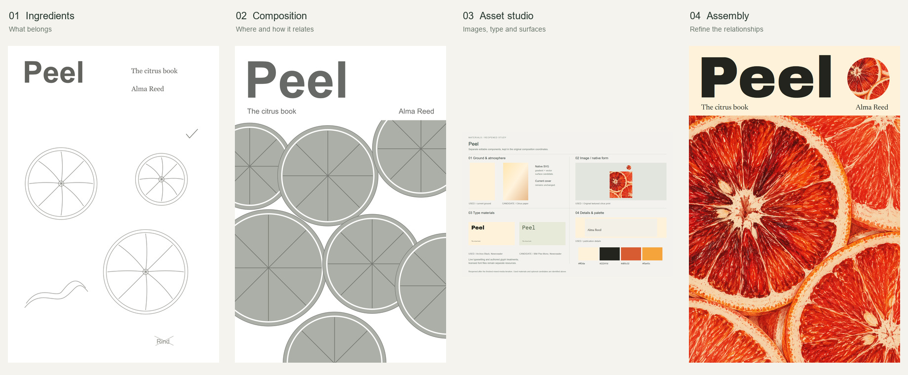](examples/process/peel-citrus-book/README.md)

*Peel — The citrus book. Follow the four views, open the sources and see how the final composition was assembled.*

## Thirteen studies

Each study page shows the four views, its editable files and the available prompt record. Click a study to follow its decisions from rough components to a refined design.

| Books and publications | Identity and products | Posters and events |
| --- | --- | --- |
| [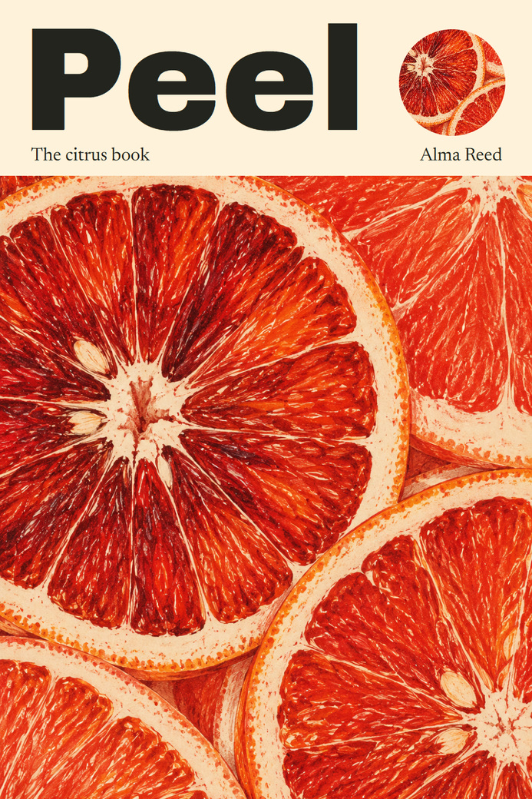](examples/process/peel-citrus-book/README.md)<br>**[Peel](examples/process/peel-citrus-book/README.md)** · A citrus monograph built around type and a textured citrus illustration. | [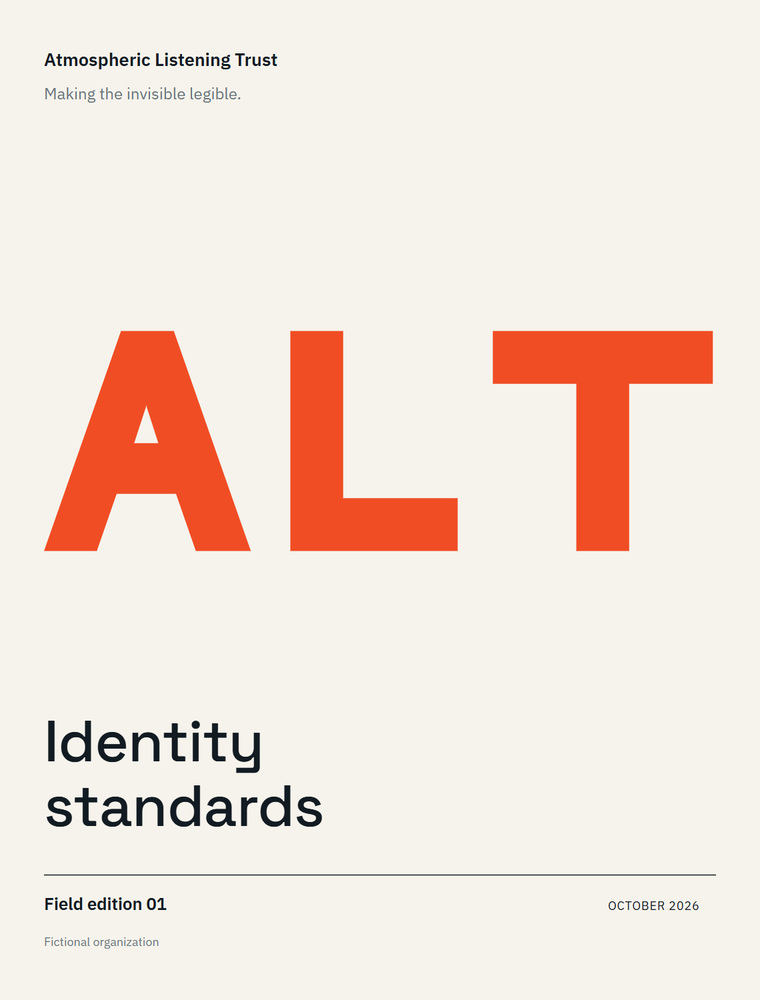](examples/process/alt-identity-standards/README.md)<br>**[ALT](examples/process/alt-identity-standards/README.md)** · An identity manual for a fictional atmospheric sensing organization. | [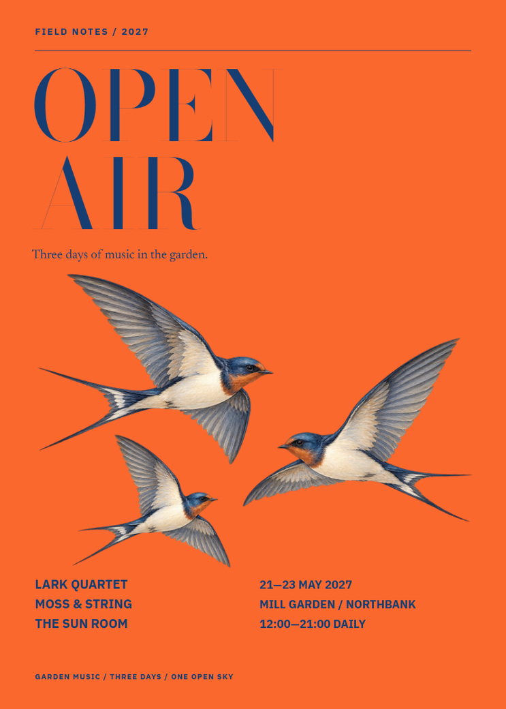](examples/process/open-air-field-notes/README.md)<br>**[Open Air](examples/process/open-air-field-notes/README.md)** · A garden-music poster with painted swallows and editable typography. |
| [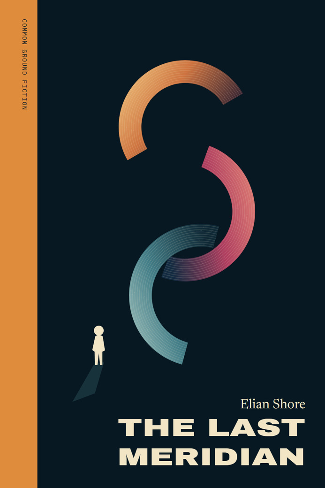](examples/process/the-last-meridian/README.md)<br>**[The Last Meridian](examples/process/the-last-meridian/README.md)** · A speculative-fiction cover for a journey across a divided world. | [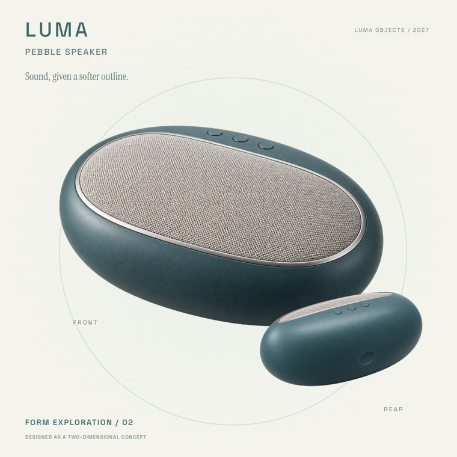](examples/process/luma-pebble-speaker/README.md)<br>**[LUMA](examples/process/luma-pebble-speaker/README.md)** · A two-dimensional product-hero concept with replaceable speaker imagery. | [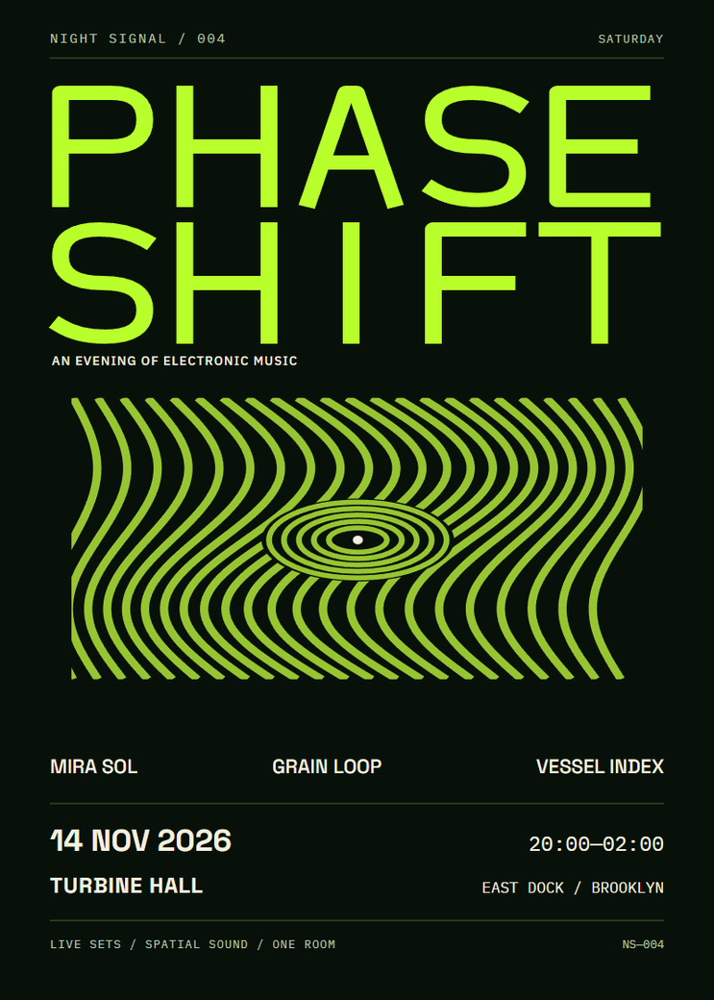](examples/process/phase-shift-night-signal/README.md)<br>**[Phase Shift](examples/process/phase-shift-night-signal/README.md)** · An electronic-music poster using a kinetic optical language. |
| [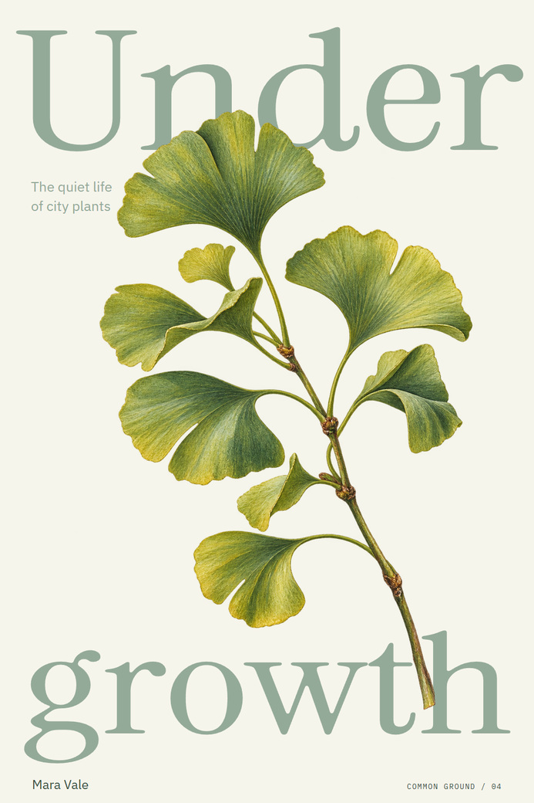](examples/process/undergrowth-field-guide/README.md)<br>**[Undergrowth](examples/process/undergrowth-field-guide/README.md)** · A botanical cover with oversized type and ginkgo foliage. | [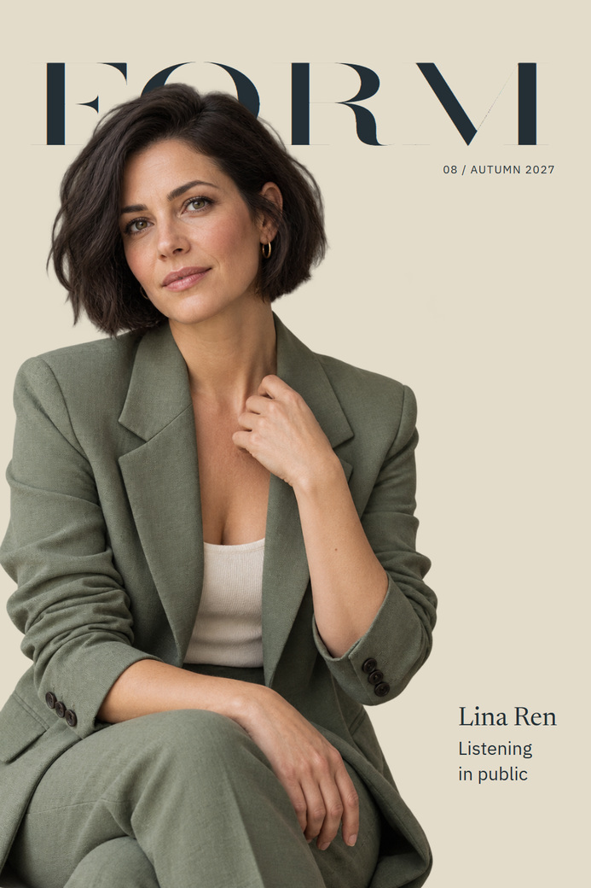](examples/process/form-listening-issue/README.md)<br>**[FORM 08](examples/process/form-listening-issue/README.md)** · A culture magazine issue about listening in public, with a generated editorial portrait. | [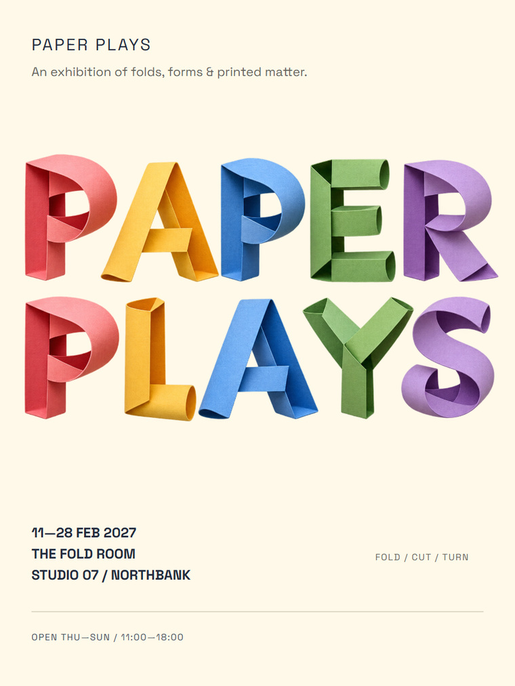](examples/process/paper-plays-exhibition/README.md)<br>**[Paper Plays](examples/process/paper-plays-exhibition/README.md)** · An exhibition poster combining paper-letter artwork and live type. |


| Systems and ideas | Biology and objects |
| --- | --- |
| [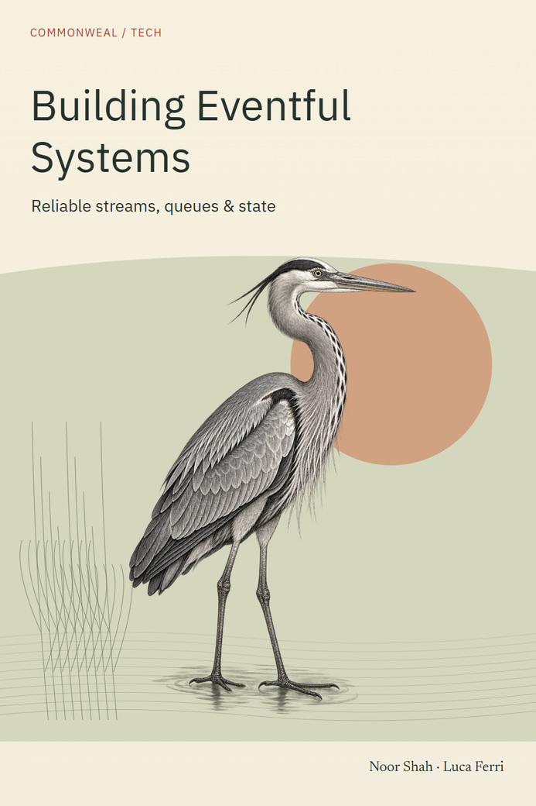](examples/process/building-eventful-systems/README.md)<br>**[Building Eventful Systems](examples/process/building-eventful-systems/README.md)** · A technical book cover about reliable streams, queues and state, paired with an engraving-style heron. | [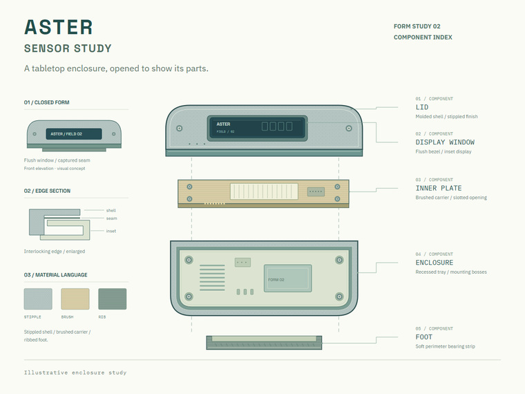](examples/process/aster-sensor-study/README.md)<br>**[ASTER](examples/process/aster-sensor-study/README.md)** · A fictional sensor enclosure study with an exploded assembly and component index. |
| [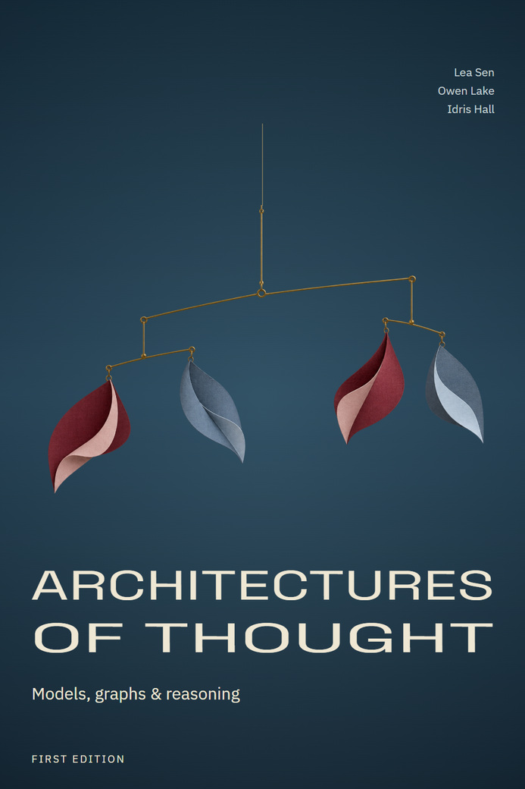](examples/process/architectures-of-thought/README.md)<br>**[Architectures of Thought](examples/process/architectures-of-thought/README.md)** · A textbook cover about models, graphs and reasoning, featuring a sculptural paper mobile. | [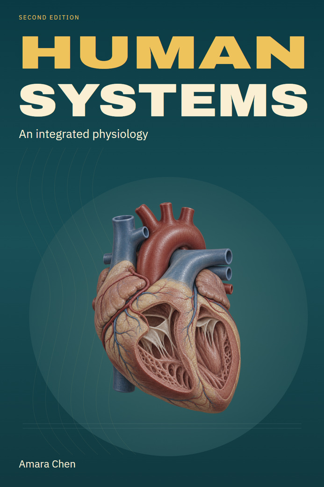](examples/process/human-systems-physiology/README.md)<br>**[Human Systems](examples/process/human-systems-physiology/README.md)** · A physiology textbook cover featuring a conceptual heart teaching model. |

The studies use original fictional content. Some use generated raster imagery as a replaceable layer; others use vector artwork. Editable SVG layout and text do not make a generated image itself a vector. LUMA and ASTER are visual concepts, not engineered products; the Human Systems heart is conceptual cover art, not an anatomical atlas. Individual pages identify assets, prompts, fonts and limitations.

## Explore each process

Open a study to see all four stages and a brief you can adapt. The stage prompts are reconstructed from the study sources for reuse; they are not original transcripts. Recorded image-generation prompts appear separately.

<details>
<summary><strong>Peel</strong> — A food monograph pairing a bold title with textured citrus imagery.</summary>

[](examples/process/peel-citrus-book/README.md)

| Stage | Reusable prompt |
| --- | --- |
| Ingredients | Collect the title, author, citrus forms and a warm red-and-cream palette as separate ingredients. |
| Composition | Place the large title above an image field; test the balance between lettering and fruit. |
| Asset studio | Develop a textured citrus illustration and choose type that can hold its own against it. |
| Assembly and refinement | Combine the artwork and editable type; refine the title width and the density of the cover. |

[Four views and editable source](examples/process/peel-citrus-book/README.md)

<details>
<summary>Recorded image prompt</summary>

**Asset 1:** `peel-citrus-texture.png`

> Use case: stylized-concept. Asset type: original finely textured citrus illustration for the image panel of an artful food book. An extreme close-up composition of several sliced blood oranges and grapefruit cross-sections, packed and cropped boldly at the edges. Exquisite organic citrus anatomy: uneven translucent juice vesicles, irregular segments, tiny seeds, thick pale pith and thin rind. It must feel tactile and finely observed rather than perfect repeated vector circles. Medium: a contemporary hand-printed botanical food illustration combining dense colored-pencil and gouache detail with slightly broken two-ink screenprint texture on warm uncoated cream paper. Restrict the colors to vivid vermilion/orange-red and warm cream, with subtle pigment variation, paper tooth, sharp fibrous detail. Full-bleed portrait-oriented art asset, no tabletop props, no surrounding room, no words, no title, no author, no logos or watermark, no book or poster mockup. Entirely original composition.

[Full prompt record](examples/process/peel-citrus-book/prompts.json)

</details>

</details>

<details>
<summary><strong>The Last Meridian</strong> — A speculative-fiction cover for a traveler crossing a divided world.</summary>

[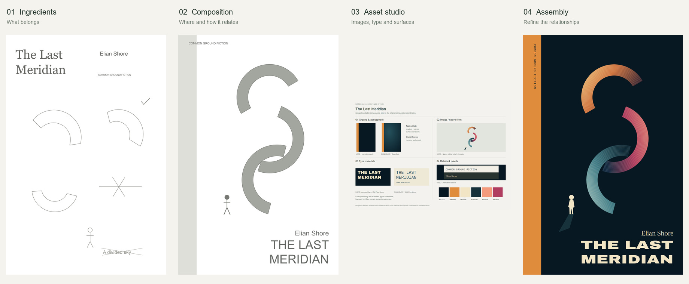](examples/process/the-last-meridian/README.md)

| Stage | Reusable prompt |
| --- | --- |
| Ingredients | Collect the title, author, horizon, divided landscape and a restrained color palette. |
| Composition | Test a split-world composition with the title and traveler readable at cover size. |
| Asset studio | Draw the landscape, dividing line and traveler as editable vector elements. |
| Assembly and refinement | Assemble the cover and adjust the relationship between the title, horizon and figure. |

[Four views and editable source](examples/process/the-last-meridian/README.md)

The selected artwork is native vector; no image-generation prompt was recorded for it.

</details>

<details>
<summary><strong>Undergrowth</strong> — A city-plant field guide with oversized type and a ginkgo sprig.</summary>

[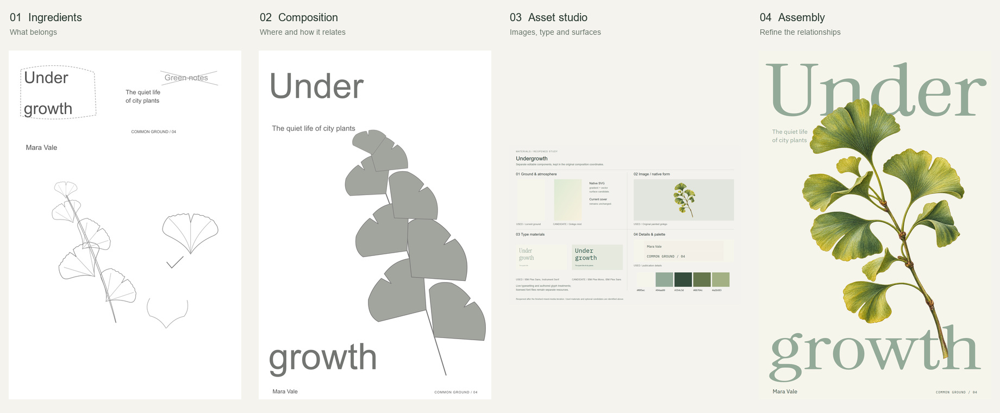](examples/process/undergrowth-field-guide/README.md)

| Stage | Reusable prompt |
| --- | --- |
| Ingredients | Gather the title, subtitle, ginkgo shapes and a quiet botanical palette. |
| Composition | Place oversized title words and foliage so both remain legible. |
| Asset studio | Develop an original ginkgo illustration and select the cover typography. |
| Assembly and refinement | Assemble the field guide cover; refine leaf placement and its overlap with the title. |

[Four views and editable source](examples/process/undergrowth-field-guide/README.md)

<details>
<summary>Recorded image prompt</summary>

**Asset 1:** `undergrowth-ginkgo.png`

> Use case: illustration-story. Asset type: original botanical illustration cutout for an illustrated plant field-guide cover; art asset only. Primary request: a fresh, richly observed ginkgo biloba sprig, one slender slightly curved stem rising diagonally from lower right toward upper left, with 10 to 12 naturally varied fan-shaped ginkgo leaves. The leaves must feel individually painted and observed, not duplicated symbols: some broad fans, some folded, one small young leaf, irregular scalloped margins and characteristic central notches, delicate radiating veins. Style: exquisite natural-history gouache and colored-pencil botanical plate, rich matte pigment, fine dry-brush and printed-paper texture within the paint, subtle waxy highlights, warm olive, pine, ochre and sage greens. Contemporary art-book illustration with real organic texture and graceful asymmetrical silhouette. Portrait composition, complete stem and leaves retained, no planter or pot, no surrounding objects. Genuine transparent background. No lettering, labels, borders, title, watermark, page or cover mockup. Entirely new artwork, not a copy of an existing botanical plate.

[Full prompt record](examples/process/undergrowth-field-guide/prompts.json)

</details>

</details>

<details>
<summary><strong>ALT</strong> — A four-page identity manual for the fictional Atmospheric Listening Trust.</summary>

[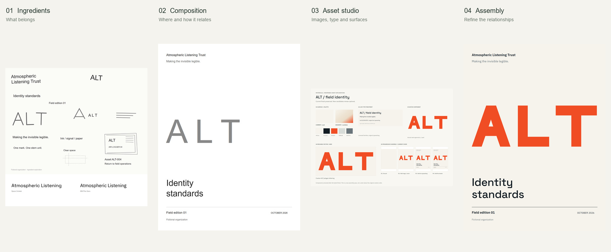](examples/process/alt-identity-standards/README.md)

| Stage | Reusable prompt |
| --- | --- |
| Ingredients | Collect the ALT name, tagline, mark ideas, palette and fictional field-equipment application. |
| Composition | Organize a four-page manual for the identity, mark, color and equipment. |
| Asset studio | Draw the polygon wordmark, palette elements and equipment as editable vectors. |
| Assembly and refinement | Assemble the pages and check consistent mark proportions, spacing and color use. |

[Four views and editable source](examples/process/alt-identity-standards/README.md)

The selected artwork is native vector; no image-generation prompt was recorded for it.

</details>

<details>
<summary><strong>FORM 08</strong> — A fictional culture magazine issue on listening in public.</summary>

[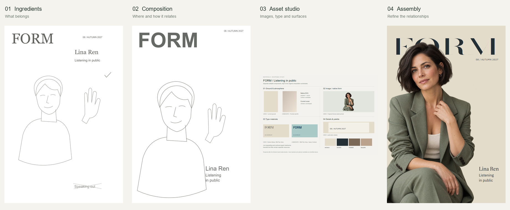](examples/process/form-listening-issue/README.md)

| Stage | Reusable prompt |
| --- | --- |
| Ingredients | Collect the FORM masthead, issue information, listening coverline and portrait direction. |
| Composition | Test the masthead, coverline and portrait as a clear magazine hierarchy. |
| Asset studio | Develop a fictional editorial portrait and select supporting typography. |
| Assembly and refinement | Assemble the cover and refine depth, portrait placement and readable type. |

[Four views and editable source](examples/process/form-listening-issue/README.md)

<details>
<summary>Recorded image prompt</summary>

**Asset 1:** `form-portrait.png`

> Use case: photorealistic-natural. Asset type: original editorial portrait cutout for a culture-magazine cover, photography asset only, no typography. Primary request: create an entirely fictional adult woman in her late thirties with a short dark bob and a thoughtful, quietly confident expression, wearing a beautifully tailored desaturated sage-green jacket over a natural ivory top. Three-quarter seated portrait, head through upper thighs, torso angled gently toward camera, one hand resting naturally near the collar/upper chest as if listening to someone off camera; complete anatomically natural hands, no floating separate hand. Beautiful face with natural skin detail, tiny pores, faint smile lines; no beauty retouch plastic. Premium independent-magazine portrait photography, medium-format film feel, soft large north-window light from camera left, very gentle shadow, subtle warm fine grain. Composition: tall portrait, subject occupies most of the asset height, head with comfortable top breathing room, shoulders and elbows intact, calm sculptural pose, minimal accessories. Isolated on a genuinely transparent background, clean natural hair edges. No text, no logos, no watermark, no frame, no magazine mockup, no copied identity or recognizable celebrity.

[Full prompt record](examples/process/form-listening-issue/prompts.json)

</details>

</details>

<details>
<summary><strong>LUMA</strong> — A two-dimensional product-hero concept for a fictional pebble speaker.</summary>

[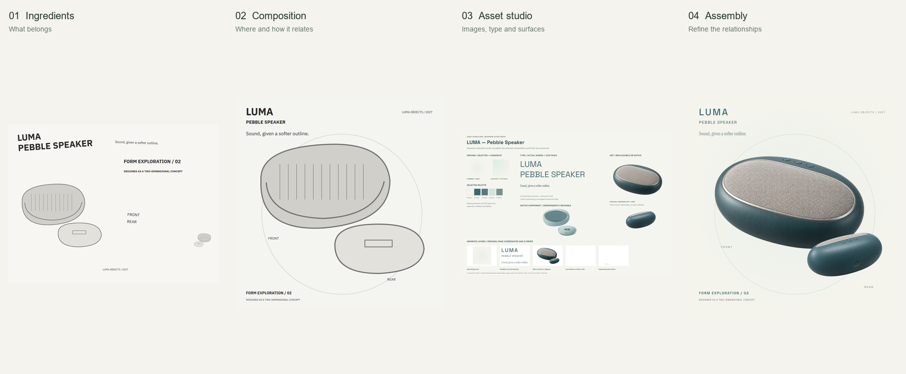](examples/process/luma-pebble-speaker/README.md)

| Stage | Reusable prompt |
| --- | --- |
| Ingredients | Gather the product name, short introduction, front and rear views and a restrained palette. |
| Composition | Arrange the primary product view, secondary view and labels as a product hero. |
| Asset studio | Develop isolated front and rear speaker images and choose legible supporting type. |
| Assembly and refinement | Assemble the two-dimensional concept and refine the emphasis of the product views. |

[Four views and editable source](examples/process/luma-pebble-speaker/README.md)

<details>
<summary>Recorded image prompts</summary>

**Asset 1:** `luma-front-v1.png`

> Use case: product-mockup. Asset type: one original product photograph cutout to place inside an editable SVG product-design study; generate only the object, not a poster, no typography. Subject: an invented LUMA pebble speaker concept, a palm-sized horizontal river-stone shaped object, softly flattened oval form with an asymmetrical but calm rounded silhouette. Premium tactile matte desaturated petrol-teal ceramic-like shell, a broad inset warm pale-gray finely woven acoustic grille on the upward-facing front, a hairline satin-aluminium lip around the grille, three tiny flush unmarked round buttons at the top edge. Convincing material grain, edge highlights and delicate join lines; restrained Scandinavian industrial design, entirely original and not based on an existing commercial product. Camera: three-quarter view from slightly above and to the left, showing the front grille and curved lower shell; the long axis is horizontal, whole object comfortably inside frame with 12 percent transparent breathing room. Lighting: very large soft studio key, gentle warm bounce, physically believable surface detail and mild reflections, premium editorial product photography, crisp but not over-sharpened. Background: genuinely transparent alpha, no floor, no scenery; a very faint soft contact shadow is optional but must stay within alpha. Constraints: exactly one closed object. No text, no logos, no lettering, no dimension arrows, no invented engineering labels, no hands, no decorative props, no platform, no second object, no exploded internal components. This is a visual concept, not a validated engineered product.

**Asset 2:** `luma-rear-v1.png`

> Use case: precise-object-edit / product-mockup. Asset type: a second-angle isolated product photograph for an editable SVG product study. The input image is the identity reference for the invented pebble-shaped speaker concept. Preserve its same softly flattened oval shell, desaturated petrol-teal fine-grain matte finish, hairline satin aluminium rim and scale of three flush unmarked buttons. Create a rear three-quarter view of the same object, with camera slightly above from the opposite side. The front grille should be mostly turned away, with only a slim hint of the pale woven surface at the upper edge. The visible rear shell is quiet and sculptural, with one small shallow unmarked rounded recess, no lettering and no elaborate functional detail. Long axis horizontal; one complete object centered with generous 15 percent clear padding. Match the previous very soft studio key, warm bounce and premium tactile editorial realism. Genuine transparent alpha background. No text, no logo, no watermark, no hands, no extra objects, no platform, no engineering labels or claims, no exploded parts. This is a 2D visual concept, not a validated manufactured product.

[Full prompt record](examples/process/luma-pebble-speaker/prompts.json)

</details>

</details>

<details>
<summary><strong>Open Air</strong> — A fictional garden-music festival poster with three painted swallows.</summary>

[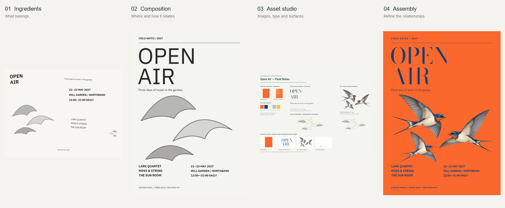](examples/process/open-air-field-notes/README.md)

| Stage | Reusable prompt |
| --- | --- |
| Ingredients | Collect the event name, dates, venue, performer names and swallow motifs. |
| Composition | Arrange the event information around an airy central illustration. |
| Asset studio | Develop three painted swallows and select typography for the event details. |
| Assembly and refinement | Combine the birds and live type; refine spacing and the reading order. |

[Four views and editable source](examples/process/open-air-field-notes/README.md)

<details>
<summary>Recorded image prompt</summary>

**Asset 1:** `swallows-gouache-v1.png`

> Use case: illustration-story. Asset type: original bird-illustration artwork for the central field of a garden-music poster; the poster typography and colored background will be built separately in editable SVG. Generate exactly three graceful swallows in flight, no scenery. Arrange them as an airy horizontal diagonal group: one larger swallow at upper left banking toward the right, one at center right gliding left, one smaller at lower left. Keep their complete silhouettes separate with generous clear gaps. Style: finely painted gouache and colored-pencil editorial natural-history illustration, warm ivory breast, cool mist-blue and slate-gray upper wings, a restrained dark navy eye and slender beak, delicate layered feather brushmarks and subtle handmade paper texture. Lyrical and light rather than cartoonish; convincing wing anatomy and forked tails, but elegant simplified shapes suit a cultural festival poster. Soft, consistent illumination and crisp cutout contours. Genuine transparent alpha background everywhere outside the birds. No branches, no landscape, no sky, no frame, no lettering, no logos, no text, no border, no fourth bird. Entirely original imagery, not a reproduction of any referenced poster. This is a visual illustration asset only.

[Full prompt record](examples/process/open-air-field-notes/prompts.json)

</details>

</details>

<details>
<summary><strong>Phase Shift</strong> — A fictional electronic-music event poster with an optical field.</summary>

[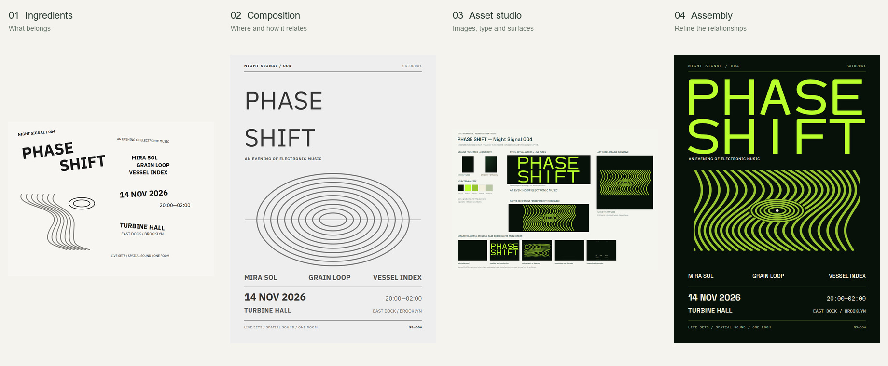](examples/process/phase-shift-night-signal/README.md)

| Stage | Reusable prompt |
| --- | --- |
| Ingredients | Gather the event name, lineup, date, venue and optical marks. |
| Composition | Arrange the title, optical field and event details into a clear hierarchy. |
| Asset studio | Draw a kinetic optical field and type treatments as editable vectors. |
| Assembly and refinement | Assemble the poster and clarify the focal point and supporting information. |

[Four views and editable source](examples/process/phase-shift-night-signal/README.md)

The selected artwork is native vector; no image-generation prompt was recorded for it.

</details>

<details>
<summary><strong>Paper Plays</strong> — An exhibition poster with sculptural folded-paper lettering.</summary>

[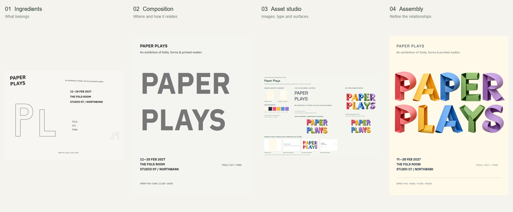](examples/process/paper-plays-exhibition/README.md)

| Stage | Reusable prompt |
| --- | --- |
| Ingredients | Collect the exhibition name, venue, dates, paper forms and vivid colors. |
| Composition | Position the sculptural title and event details as a readable poster. |
| Asset studio | Develop folded-paper lettering artwork and choose clear supporting typography. |
| Assembly and refinement | Assemble the artwork and live type; simplify the typography and refine spacing. |

[Four views and editable source](examples/process/paper-plays-exhibition/README.md)

<details>
<summary>Recorded image prompt</summary>

**Asset 1:** `paper-sculpture-v1.png`

> Use case: stylized-concept / product-mockup. Asset type: a photographed physical paper-letter sculpture to be placed as a replaceable artwork asset within an editable exhibition-poster SVG. Generate the sculpture only, not a finished poster. Subject: two carefully aligned rows of original sculptural letters made by folding and curling thick colored paper, spelling exactly PAPER on the first row and PLAYS on the second row. Text, verbatim: PAPER / PLAYS. Five letters in each row. Letters must remain immediately readable, with clear counters and complete silhouettes. Invent the letter construction rather than imitating a known typeface: broad paper bands, folded returns, occasional rolled edges, visible paper thickness and believable joins. Letter colors move across coral-pink, saffron yellow, cornflower blue, leaf green and lilac, with each letter a distinct sheet color and a darker folded reverse. Subtle fibrous paper texture, crisp physical cut edges and soft tiny self-shadows. Camera: near-frontal with a small above-right perspective so folded depth is visible; both rows have a level baseline; generous transparent padding around all letters, no letter touching the frame. Lighting: diffuse bright tabletop studio light, gentle warm bounce, refined museum design-photography quality. Genuine transparent alpha background, no tabletop or cast shadow plane. No other words, no captions, no logos, no border, no graphic poster background, no people, no tools or props. Original physical lettering artwork only.

[Full prompt record](examples/process/paper-plays-exhibition/prompts.json)

</details>

</details>


<details>
<summary><strong>Building Eventful Systems</strong> — A technical book cover about reliable streams, queues and state, paired with an engraving-style heron.</summary>

[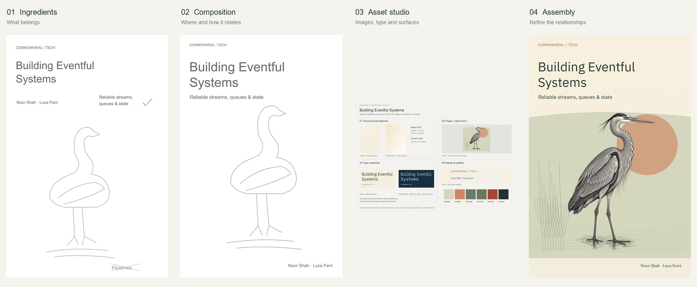](examples/process/building-eventful-systems/README.md)

| Stage | Reusable prompt |
| --- | --- |
| Ingredients | Gather the title, subtitle, authors, heron and compact technical-book type. |
| Composition | Balance a compact title hierarchy against a tall bird illustration. |
| Asset studio | Develop an isolated engraving-style heron and select readable type. |
| Assembly and refinement | Assemble the cover and refine the relationship between the illustration and the book details. |

[Four views and editable source](examples/process/building-eventful-systems/README.md)

<details>
<summary>Recorded image prompt</summary>

**Asset:** `eventful-heron-engraving.png`

> Use case: illustration-story. Asset type: original engraving-style natural-history bird illustration for a technical book cover, illustration asset only. A tall grey heron standing in a shallow ripple of water, full elegant bird from crest to the complete long thin legs and toes, side profile facing right, anatomically plausible S-curved long neck and long straight pointed bill, calm attentive stance. Newly drawn in the tradition of an exceptionally fine copperplate natural-history engraving: thousands of delicate black ink hatch and cross-hatch marks, exquisite layered wing-feather detail, subtle stippled tonal transitions on the neck and breast, tiny precise eye, a few spare engraved water ripples beneath the feet. Primarily monochrome dark charcoal ink with restrained pale warm-grey shading. Genuine transparent background, crisp isolated silhouette, no rectangular paper sheet, no frame. Leave comfortable breathing room around the entire bird; do not crop feet, bill or crest. No labels, words, scientific captions, numbers, logos, signatures or watermark. Entirely original drawing, not a reproduction of an antique plate.

[Full prompt record](examples/process/building-eventful-systems/prompts.json)

</details>

</details>

<details>
<summary><strong>Architectures of Thought</strong> — A textbook cover about models, graphs and reasoning, featuring a sculptural paper mobile.</summary>

[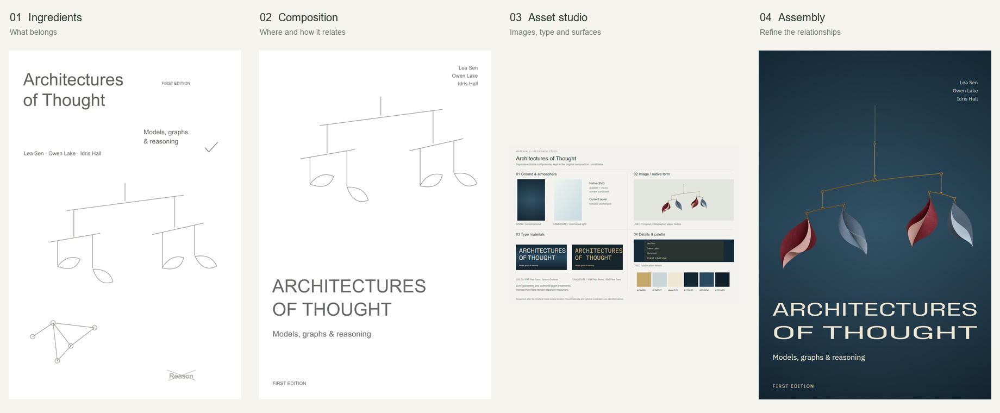](examples/process/architectures-of-thought/README.md)

| Stage | Reusable prompt |
| --- | --- |
| Ingredients | Gather the title, edition, authors and forms suggesting a balanced paper mobile. |
| Composition | Position the title and mobile in distinct fields with a clear reading order. |
| Asset studio | Develop an isolated paper-mobile image and choose an editorial type treatment. |
| Assembly and refinement | Combine the mobile and editable cover text; refine spacing and visual balance. |

[Four views and editable source](examples/process/architectures-of-thought/README.md)

<details>
<summary>Recorded image prompt</summary>

**Asset:** `thought-paper-mobile.png`

> Use case: product-mockup. Asset type: original sculptural paper-mobile photograph cutout for the upper image field of an elegant technical book cover; photograph of an object only, no typography. Create a real hand-assembled balanced hanging mobile with a slender warm-brass central vertical suspension, one long delicately tilted horizontal brass rod, two shorter branch rods hung beneath it, and exactly four curved folded-paper leaf forms at the ends. Two leaves are matte oxblood/burgundy with pale rose folded facets, two are muted slate-blue with pale blue folded facets. Sophisticated minimalist kinetic sculpture, actual thin paper edges and delicate fibers, small visible brass connection loops, physically plausible joints and gravity, asymmetrical but balanced. Front three-quarter product photograph, the entire hanging sculpture including top wire and all four paper leaves fully in frame. Soft gallery daylight, beautiful soft highlights and subtle photographic grain, tactile physical paper, very high detail. Isolated on a genuine transparent background, no plinth, no room, no text, no logos, no book/cover mockup, no watermark.

[Full prompt record](examples/process/architectures-of-thought/prompts.json)

</details>

</details>

<details>
<summary><strong>Human Systems</strong> — A physiology textbook cover featuring a conceptual heart teaching model.</summary>

[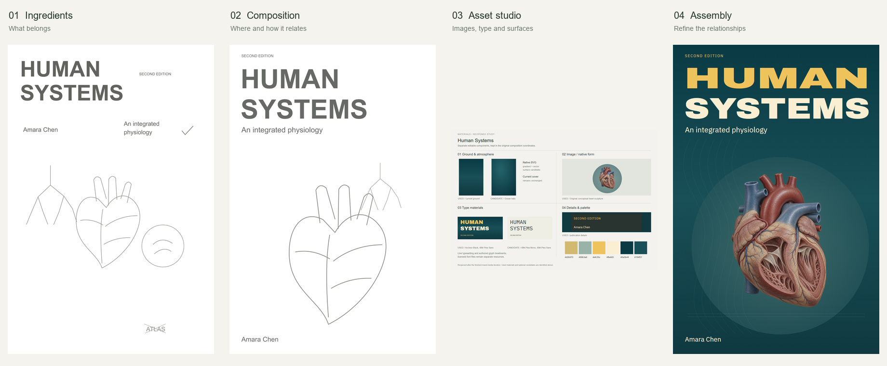](examples/process/human-systems-physiology/README.md)

| Stage | Reusable prompt |
| --- | --- |
| Ingredients | Gather the title, subtitle, author, edition and a heart-model concept. |
| Composition | Arrange the title and central heart image for an educational cover. |
| Asset studio | Develop an isolated conceptual teaching-model illustration and select the cover typography. |
| Assembly and refinement | Assemble the image and editable type; refine their scale and hierarchy. |

[Four views and editable source](examples/process/human-systems-physiology/README.md)

<details>
<summary>Recorded image prompt</summary>

**Asset:** `human-heart-model.png`

> Use case: scientific-educational. Asset type: original sculptural educational illustration cutout for a physiology textbook cover, artwork only, no labels or typography. Create a beautifully crafted, anatomically convincing human-heart teaching model, three-quarter anterior view, with one restrained cutaway window into the ventricles so muscular chamber structure can be appreciated. It should look like a sophisticated hand-painted wax/resin museum teaching model photographed in soft studio light, tactile matte surfaces and subtle sculptural tool marks, warm terracotta and muted coral myocardium, deep red major arteries, restrained blue venous vessels, tiny precise surface coronary vessels. Complete heart and major superior vessels fully in frame, centered with generous breathing room. Educational and elegant, no blood, wounds, gore or surgical scene. Genuine transparent background, natural soft edge shadows only. No letters, diagrams, numbers, arrows, captions, titles, branding, logos, watermark, tabletop or surrounding room. This is a newly created conceptual cover illustration, not a diagnostic image or replica of a specific existing museum model.

[Full prompt record](examples/process/human-systems-physiology/prompts.json)

</details>

</details>

<details>
<summary><strong>ASTER</strong> — A fictional sensor enclosure study with an exploded assembly and component index.</summary>

[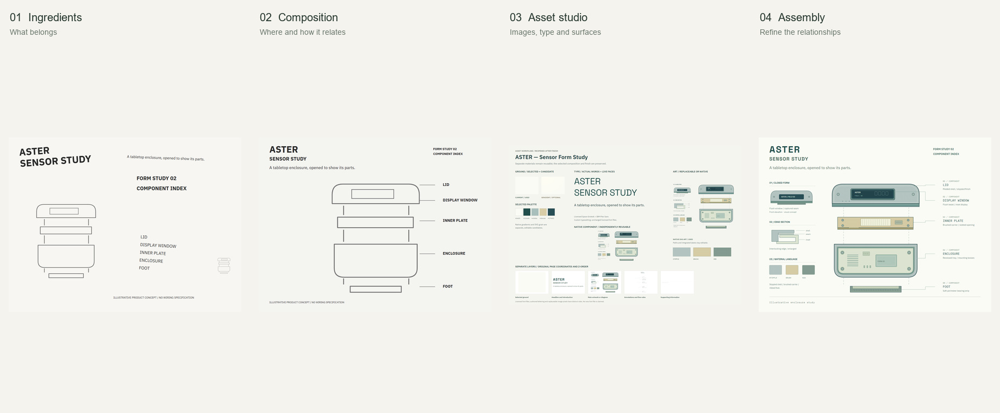](examples/process/aster-sensor-study/README.md)

| Stage | Reusable prompt |
| --- | --- |
| Ingredients | Gather the enclosure, lid, display window, inner plate, foot and component labels. |
| Composition | Arrange the rough enclosure illustration, component labels and title in a neutral hierarchy. |
| Asset studio | Draw editable enclosure components, surface textures and technical marks in SVG. |
| Assembly and refinement | Refine the exploded assembly and labels; add a closed form and enlarged edge section to the final study. |

[Four views and editable source](examples/process/aster-sensor-study/README.md)

The selected artwork is native vector; no image-generation prompt was recorded for it.

</details>

## Try the process

Invoke Ingenium in your client, then adapt this newly written starting prompt to your project:

```text
Use Ingenium to help me develop [describe the artifact and its audience].
The content is: [paste the words or attach the source]. I want it to feel
[describe the mood], while keeping [constraints] intact.

First show rough ingredients I can select from. Then show a neutral
composition that makes the hierarchy clear. Develop the assets separately
where useful, and assemble an editable design from the pieces we choose.
Show each stage and tell me what can still be changed. Ask when a choice
would materially affect the direction. Preserve earlier versions.
```

Then guide a revision with a specific change and a boundary:

```text
Keep the selected composition, wording and imagery. Make the title easier
to read and reduce the visual weight of the supporting details. Save a new
editable revision and show me the result at its intended size.
```

These are reusable prompts written for this README, not transcripts of the historical study sessions. The study pages link to recorded image-generation prompts where they exist; a vector-only study may have no image-generation prompt.

## Get started

The creative guidance needs no Node runtime, server or API key of its own. Your client supplies the model and file tools. The optional terminal installer uses Node/npm; [manual installation](docs/install.md#manual-install-without-node) does not.

### Codex app or CLI

Run in the project where you want to use Ingenium:

```sh
npx skills@1.7.2 add ajhcs/Ingenium --skill ingenium --agent codex
```

Open a fresh Codex conversation in that project, confirm Ingenium appears in the skill picker, and invoke **`$ingenium`** with your brief.

### Claude Code

Run in your project:

```sh
npx skills@1.7.2 add ajhcs/Ingenium --skill ingenium --agent claude-code
```

Start Claude Code there, check `/skills`, and use **`/ingenium`** with your brief. Both commands use the third-party [Vercel skills installer](https://github.com/vercel-labs/skills) and install project-local guidance. Review its prompt before confirming; it can replace an existing skill of the same name. See [update, remove and troubleshooting](docs/install.md#update-or-remove).

### ChatGPT

Without custom skill upload, copy the [Ingenium instructions](skills/ingenium/SKILL.md) into your conversation, then add your brief. If a named reference is needed, attach that file from the [guidance ZIP](https://github.com/ajhcs/Ingenium/raw/refs/heads/main/site/assets/downloads/ingenium-skill.zip). This uses the instructions in that conversation; it does not install a persistent skill.

If your workspace has custom Skills enabled, use **Plugins → Skills → Create → Upload from your computer**. Do not assume a personal Pro subscription includes this feature. See [workspace eligibility and setup](docs/install.md#chatgpt).

### Claude chat

[Download the guidance ZIP](https://github.com/ajhcs/Ingenium/raw/refs/heads/main/site/assets/downloads/ingenium-skill.zip), then go to **Customize → Skills → + → Create skill → Upload a skill**. Upload the ZIP, enable Ingenium and start a new chat with “Use Ingenium.” Code execution and file creation must be enabled. See [Claude chat setup](docs/install.md#claude-chat).

## More ways to work

Ingenium can also help with interaction studies, type specimens, color families, diagrams and design critique. Choose the method that answers your question; a static study describes intended behavior rather than proving that an application implements it.

[First-study walkthrough](docs/quickstart.md) · [Design methods](docs/method-studies.md) · [Editable examples](examples/release/README.md) · [Source synthesis](docs/source-synthesis.md) · [Installation and troubleshooting](docs/install.md)
