# Ingenium

**Turn a rough idea into a design you can keep working on.**

A creative skill for Codex and Claude, with a guided route for ChatGPT. Explore directions, refine the one you choose, and keep editable files.

[Install](#start-in-your-client) · [Setup by client](docs/install.md) · [Live demos](https://ajhcs.github.io/Ingenium/) · [Editable studies](examples/release/README.md)

**Explore:** [More outputs](#more-editable-outputs) · [Copy-ready prompts](#prompt-ideas) · [Optional workflows](#selective-source-synthesis)

## Without Ingenium / With Ingenium

Same fictional briefs, preserved screenshots. These historical runs used different resources and revisions; they are illustrative comparisons. [How they were made](docs/readme-comparisons.md). Click any image for full size.

**Website · Fieldwork**

[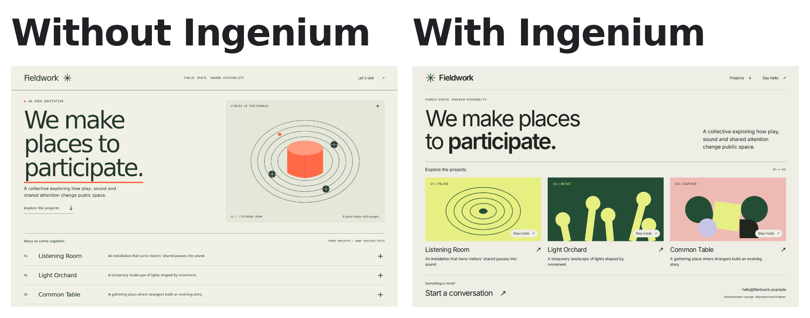](docs/assets/comparisons/website-comparison.png)

**Publication cover · Common Ground**

[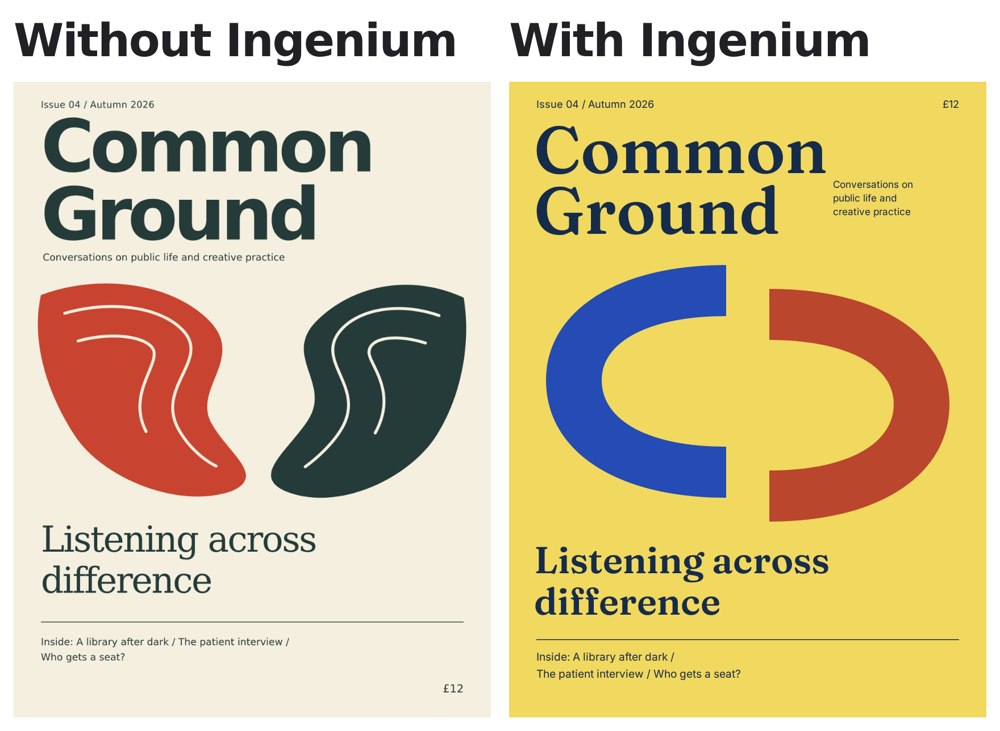](docs/assets/comparisons/cover-comparison.png)

**Identity · Manyfold**

[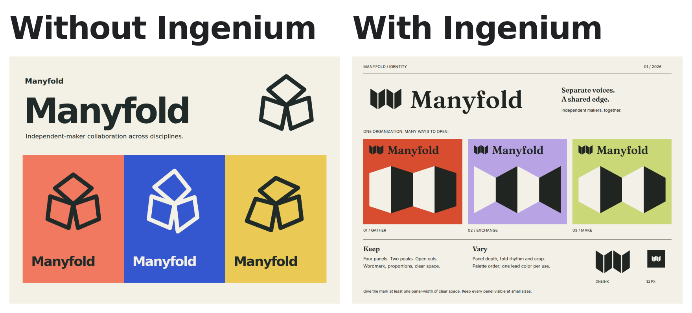](docs/assets/comparisons/identity-comparison.png)

**Wayfinding · Junction House lobby directory**

[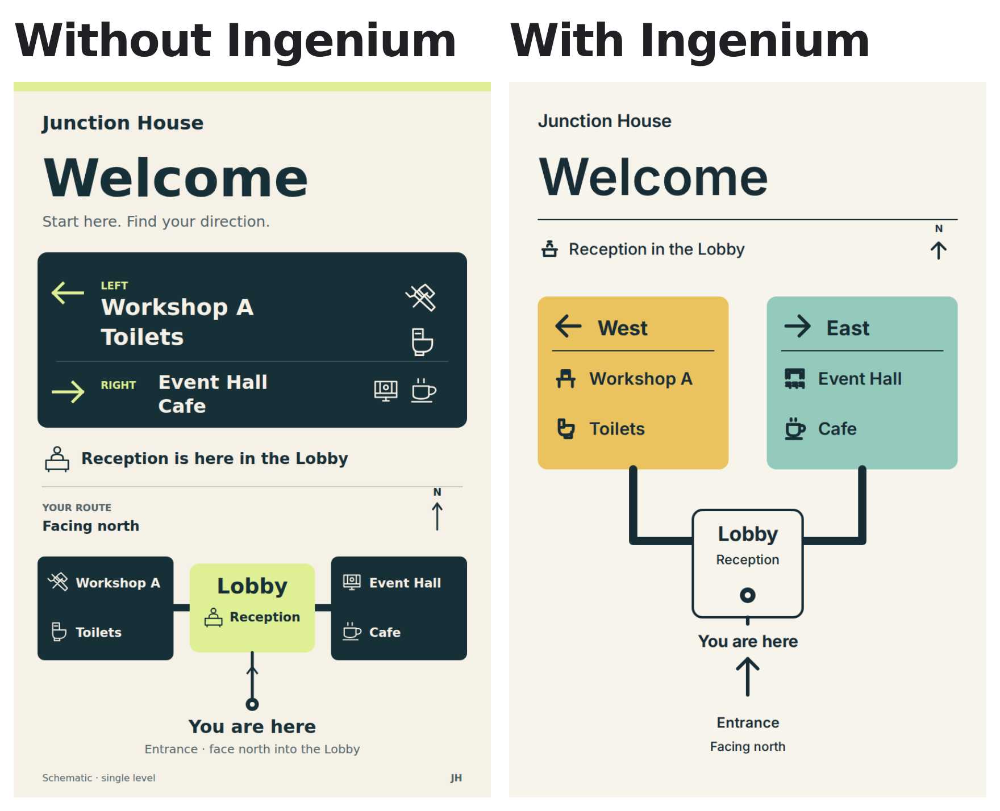](docs/assets/comparisons/wayfinding-comparison.png)

[Full-size originals and methodology](docs/readme-comparisons.md) · [Try the website](https://ajhcs.github.io/Ingenium/studies/fieldwork/)

## Start in your client

The creative guidance needs no Node runtime, server or API key of its own. Your client supplies the model and file tools. The optional terminal installer below uses Node/npm; [manual installation](docs/install.md#manual-install-without-node) does not.

### Codex app or CLI

Run in the project where you want to use Ingenium:

```sh
npx skills@1.7.2 add ajhcs/Ingenium --skill ingenium --agent codex
```

Open a fresh Codex conversation in that project, confirm Ingenium appears in the skill picker, and invoke **`$ingenium`** with your brief.

### Claude Code

Run in your project:

```sh
npx skills@1.7.2 add ajhcs/Ingenium --skill ingenium --agent claude-code
```

Start Claude Code there, check `/skills`, and use **`/ingenium`** with your brief. Both commands use the third-party [Vercel skills installer](https://github.com/vercel-labs/skills) and install project-local guidance. Review its prompt before confirming; it can replace an existing skill of the same name. See [update, remove and troubleshooting](docs/install.md#update-or-remove).

### ChatGPT

Without custom skill upload, copy the [Ingenium instructions](skills/ingenium/SKILL.md) into your conversation, then add your brief. If a named reference is needed, attach that file from the [guidance ZIP](https://github.com/ajhcs/Ingenium/raw/refs/heads/main/site/assets/downloads/ingenium-skill.zip). This uses the instructions in that conversation; it does not install a persistent skill.

If your workspace has custom Skills enabled, use **Plugins → Skills → Create → Upload from your computer**. Do not assume a personal Pro subscription includes this feature. See [workspace eligibility and setup](docs/install.md#chatgpt).

### Claude chat

[Download the guidance ZIP](https://github.com/ajhcs/Ingenium/raw/refs/heads/main/site/assets/downloads/ingenium-skill.zip), then go to **Customize → Skills → + → Create skill → Upload a skill**. Upload the ZIP, enable Ingenium and start a new chat with “Use Ingenium.” Code execution and file creation must be enabled. See [Claude chat setup](docs/install.md#claude-chat).

## Try it

After invoking the skill—or pasting its instructions—send:

> Make a poster for a fictional event called Evening Garden, on 24 May at 6 pm. The invitation is “An evening of listening, planting and conversation.” It should feel quiet and welcoming. Show two distinct organizing ideas as editable SVG files, keeping the wording the same. Use no image generation or external references. Preview the files if your tools allow it, and give me the actual files to open.

Then refine a choice:

> Keep the first study's layout and wording for this poster. Make only the title feel less formal. Save a new editable version and keep the previous files.

Ask for as much or as little as you need. A single study, a text comparison or a useful question can be enough. [Continue the first-study walkthrough](docs/quickstart.md).

## Choose the study that answers your question

Invoke `$ingenium`, `/ingenium`, or “Use Ingenium” in your client, then ask for the method and supply your content. For example: “Use Ingenium to show the same assignment screen before saving, while saving, and after a failed save. Preserve the draft and keep the selected order fixed.” These are selectable methods, not eight required steps. A study defines an artifact; implementing its depicted product requires its own scope.

| Method | Use it to explore | Editable example | Maturity and evidence boundary |
| --- | --- | --- | --- |
| Structural wireframe | Content hierarchy, grouping and available actions before styling | [Queue structure](examples/methods/source/structural-wireframe.svg) | Static structure; pixels checked, action reachability untested. |
| Wireflow | Recognizable views connected by actions, conditions and recovery | [Assignment route](examples/methods/source/wireflow.svg) | Static route; navigation and cancellation unexecuted. |
| Same-screen state sequence | Changes within one workspace; draft, validation and persistence boundaries | [Assignment states](examples/methods/source/state-sequence.svg) | Static state specification; runtime editing, validation and undo untested. |
| Complex desktop workflow | Selection and information shared across navigation, surface and inspector | [Desktop workspace](examples/methods/source/desktop-workflow.svg) | Static coordinated-workspace proposal; focus and concurrency untested. |
| Empty and error states | Distinct causes, retained input and realistic next actions | [Recovery states](examples/methods/source/empty-error.svg) | Static recovery specification; real storage, service and retry untested. |
| Element collage | A possible vocabulary of type, shape, color and surface fragments | [Visual fragments](examples/methods/source/element-collage.svg) | Original fragments and treatment variants; no selected winner or brand approval. |
| Palette families | The same semantic roles and applied content across color families | [Color comparison](examples/methods/source/palette-families.svg) | Declared opaque pairs measured; live focus, hover and dark mode untested. |
| Fontplate / type specimen | Actual text, role sizes, density, numbers and character distinctions | [Type roles](examples/methods/source/fontplate.svg) | Static type comparison; system fallback and per-glyph face identity unresolved. |

For critique or refinement, tie each recommendation to task evidence and the choices it preserves. [Selected Impeccable adaptation](docs/impeccable-review.md) · [Controlled before/after example](examples/review/README.md).

The original **Relay** studies below use a fictional repair-team workspace. Ingenium's existing paper, green and acid-yellow editorial framing surrounds an illustrative Relay palette; the product styling is a scoped example choice. Each is editable SVG with a separate PNG preview. Click a preview to inspect the full 1200 × 800 render.

| Structure and route | State and workspace |
| --- | --- |
| [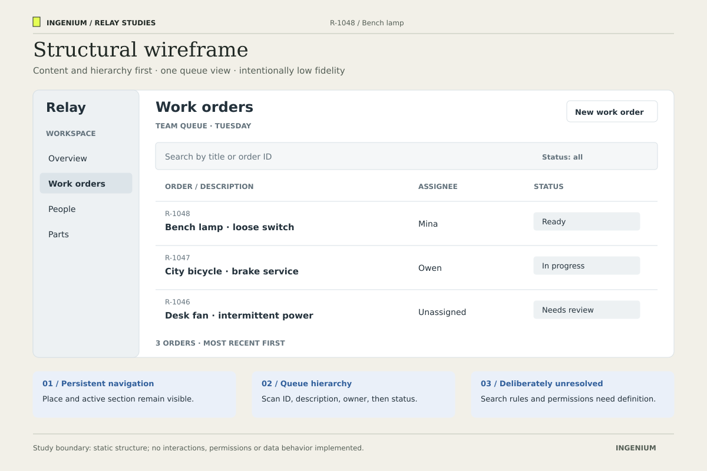](examples/methods/previews/structural-wireframe.png) | [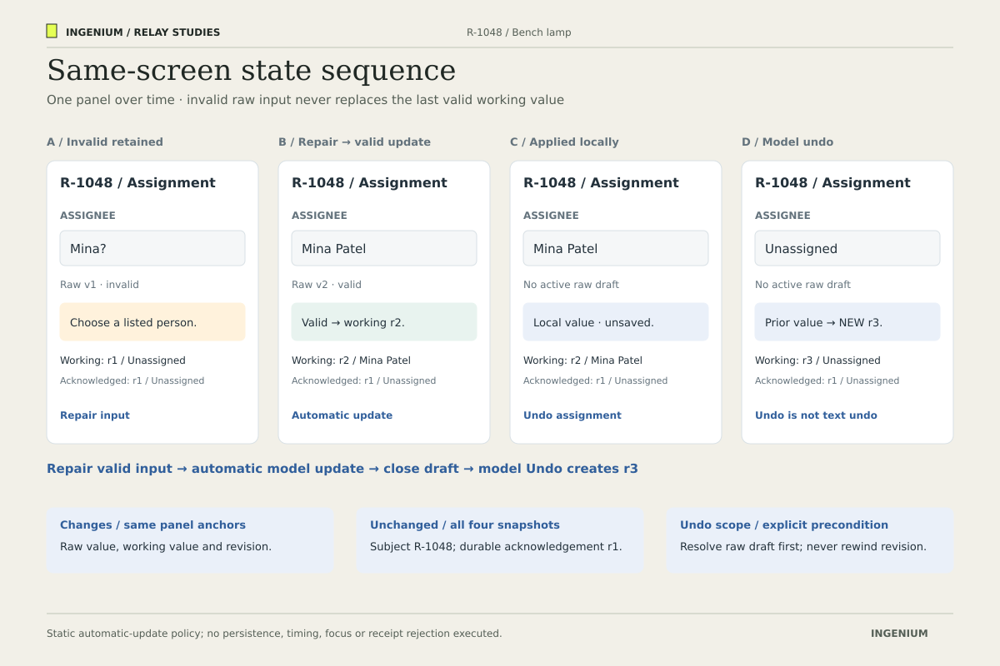](examples/methods/previews/state-sequence.png) |
| [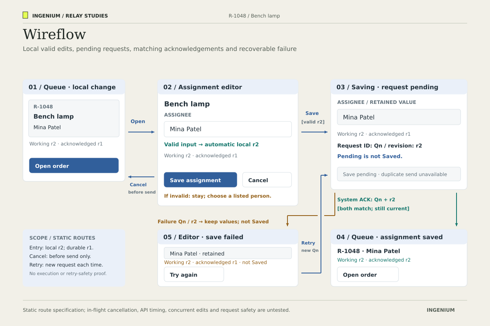](examples/methods/previews/wireflow.png) | [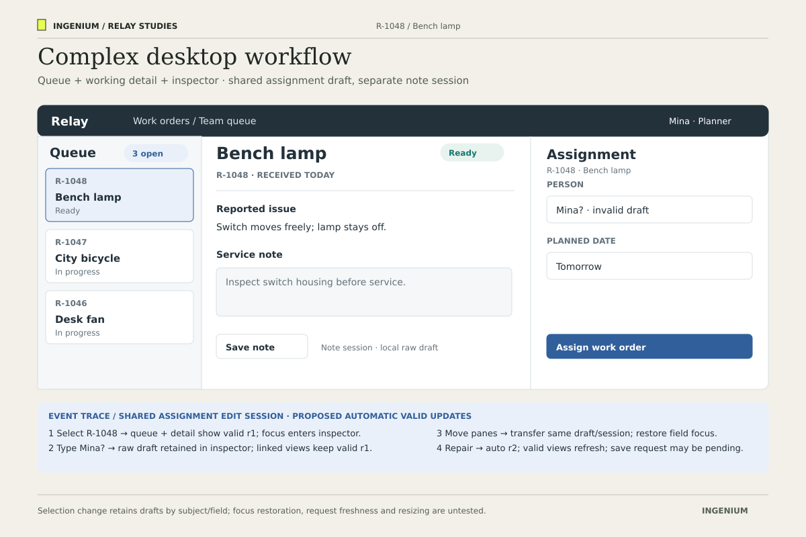](examples/methods/previews/desktop-workflow.png) |
| [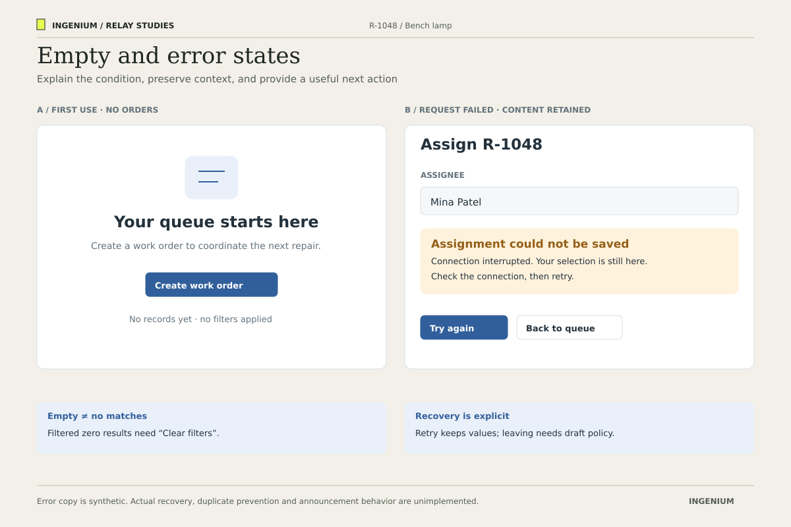](examples/methods/previews/empty-error.png) | [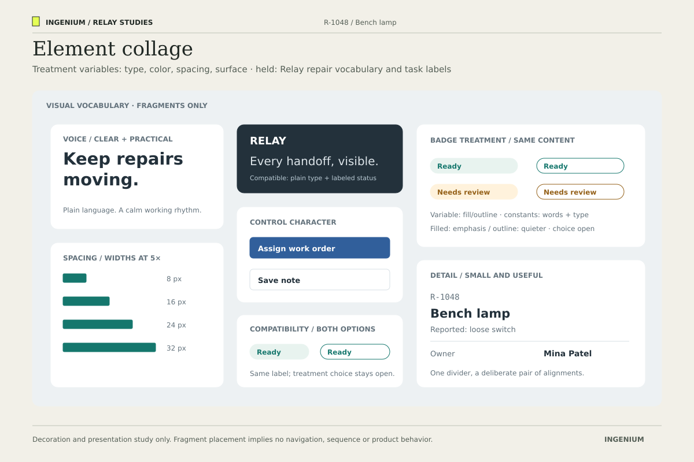](examples/methods/previews/element-collage.png) |
| [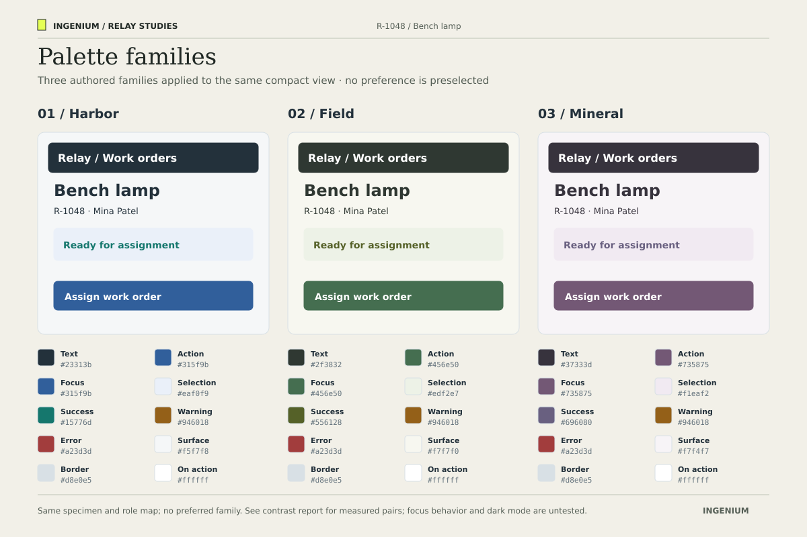](examples/methods/previews/palette-families.png) | [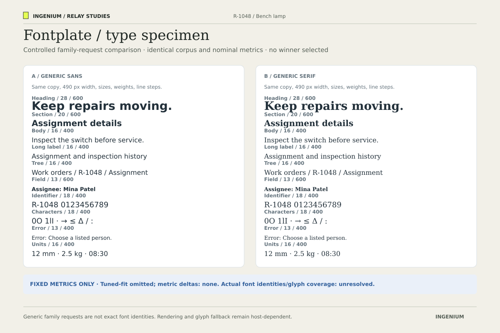](examples/methods/previews/fontplate.png) |

These are static design proposals. Labels and arrows specify intended behavior; no save, retry, keyboard path or backend is executed by an SVG. A collage explores decoration; it does not establish semantic relationships. System font fallback can change metrics. Source hashes, tests and renders establish bounded evidence, not taste, complete accessibility, engineering adequacy or user acceptance. For consequential interactions, the existing [connected-wireframe workflow](skills/ingenium/references/interaction-sketches.md) still applies, including authoritative model bindings and review where relevant.

The portable skill loads [method contracts](skills/ingenium/references/design-methods.md) only when useful. The full checkout also provides dependency-free example generation and optional PNG export:

```sh
# Node 22+; each destination must be new.
node tools/generate-method-studies.mjs work/relay-sources
node tools/render-method-studies.mjs work/relay-sources work/relay-previews
# Existing optional Sharp only; no automatic installation.
node --test tests/method-studies.test.mjs
```

The renderer can use `--renderer-dir EXISTING_INSTALL`. The standalone guidance ZIP contains the method reference, without these helper scripts or example assets. [Invocation, artifact contracts and limits](docs/method-studies.md) · [Validation and provenance](docs/method-studies-validation.md) · [Long-title regression renders](examples/methods/regressions/title-width/README.md).

## More editable outputs

**HTML** · **SVG** · **PNG previews** · **Presentation studies** · **Diagram choices**

These original synthetic examples are real rendered files you can open and keep editing. Click a preview for full size, or follow its source link to inspect how it was made.

| Keep meaning across appearances | Change the question, change the diagram |
| --- | --- |
| [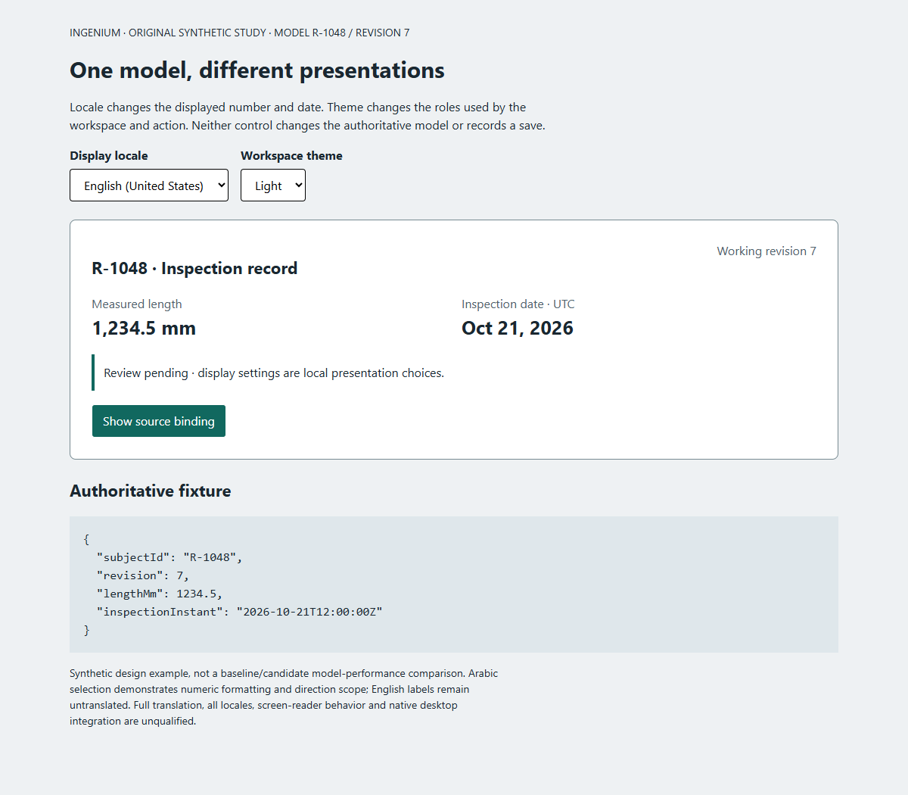](examples/source-synthesis/en-US-light-1200.png) | [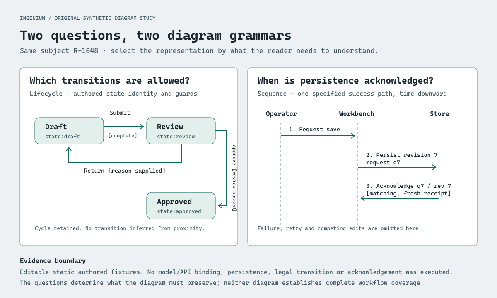](examples/source-synthesis/diagram-reviewed.png) |
| **Presentation contexts · editable HTML.** One record, local display choices. [Open the source](examples/source-synthesis/presentation.html) · [Rendered evidence](examples/source-synthesis/evidence.json). | **Diagram meaning · editable SVG.** Explore legal state changes or message order without conflating them. [Open the source](examples/source-synthesis/diagram.svg) · [Render evidence](examples/source-synthesis/diagram-evidence.json). |
| [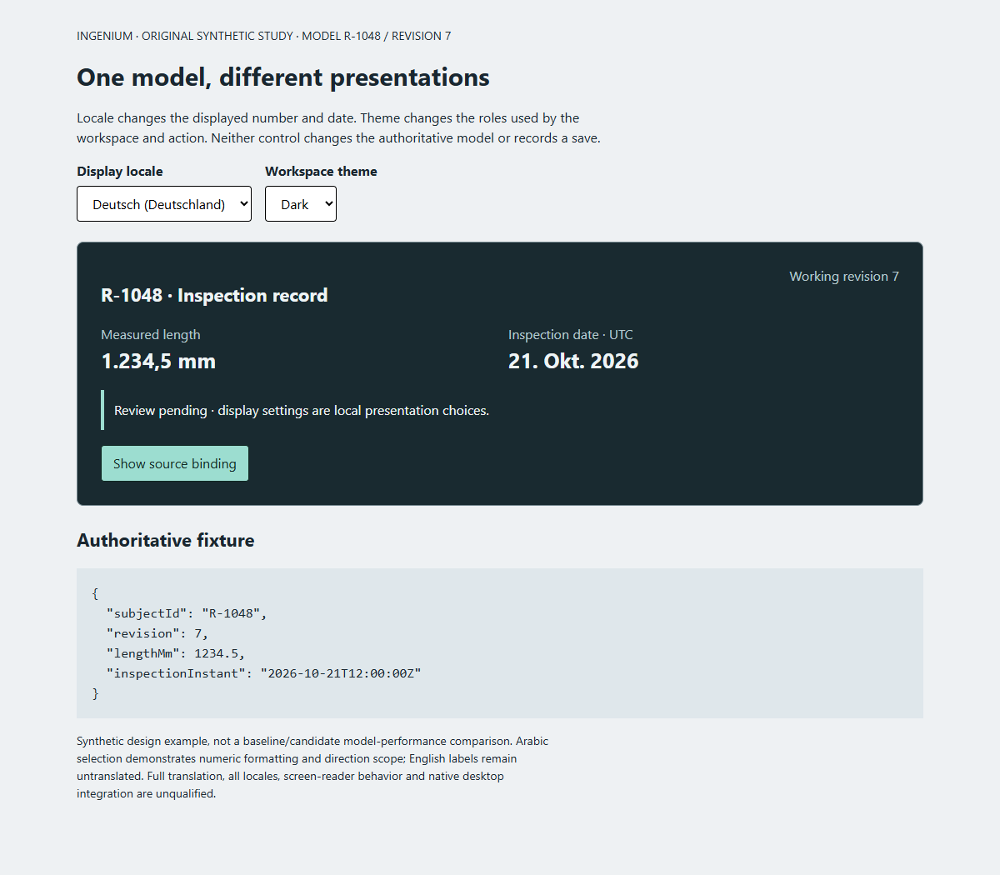](examples/source-synthesis/de-DE-dark-1200.png) | [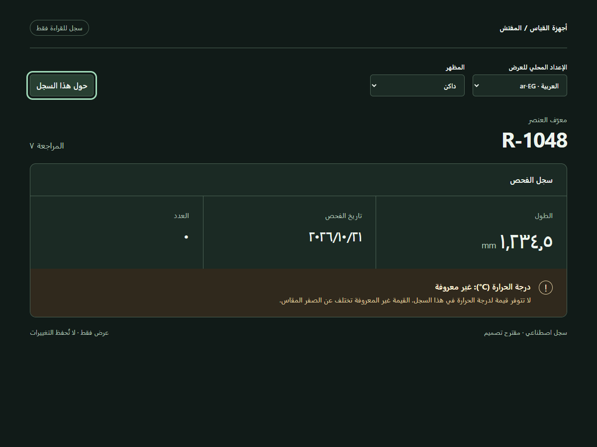](examples/source-synthesis/matched/candidate/observed-ar-dark-desktop.png) |
| **Theme and locale · same source.** Compare role colors and formatted values while retaining the underlying data. [Try the controls locally](examples/source-synthesis/presentation.html) · [Scope of the study](examples/source-synthesis/README.md). | **Observed browser fixture · editable HTML.** Locale/theme controls and the native dialog were exercised in the matched task. [Open the source](examples/source-synthesis/matched/candidate/inspector.html) · [Observed results](examples/source-synthesis/matched/README.md). |

The presentation and diagram examples were authored to demonstrate particular distinctions; the diagrams are static specifications. The inspector belongs to a separate observed task in which both baseline and candidate passed the tested mechanical conditions. [Examples, provenance and limits](examples/source-synthesis/README.md) keep these evidence types separate. All four previews use original synthetic content and system fonts; no new third-party assets are introduced.

### Use an example as a starting point

Open an editable HTML or SVG source from the gallery to explore it locally. For your own work, invoke Ingenium in your client, provide your content or current file, and choose the question you want to resolve. You can ask for a fragment, a comparison or a finished artifact; the examples do not prescribe a layout or sequence.

For a focused follow-up, describe both the change and what should stay settled:

```text
Use Ingenium with the attached study. Keep its wording, geometry and selected
color family. Make only the heading hierarchy easier to scan. Save a separate
editable revision and show the changed region at its intended size.
```

## Prompt ideas

After invoking Ingenium, copy a prompt below and replace the sample content as needed. These are starting points, not required stages. Available file creation and preview tools depend on your client; the artifact's checks should describe what actually ran.

<details>
<summary><strong>Presentation contexts</strong> — one record across locale and theme</summary>

```text
Make a small editable HTML inspector for this synthetic read-only record:
ID R-1048, revision 7, length 1234.5 mm, inspection date 2026-10-21
(a calendar date), temperature unknown, count 0. Let me explore en-US,
de-DE and ar-EG presentation and light/dark appearance. Keep a warning
region locally dark. Preserve the canonical values and distinguish zero
from unknown. Include an explanatory overlay; no backend or persistence.
Preview the result and report the interactions you actually exercised.
```

[Presentation guidance](skills/ingenium/references/presentation-context.md) · [Related exercised example](examples/source-synthesis/matched/README.md).

</details>

<details>
<summary><strong>Diagram meaning</strong> — show the relationship the reader needs</summary>

```text
Show which transitions can return this synthetic record to work:
Draft → Review on Submit [complete]; Review → Draft on Return
[reason supplied]; Review → Approved on Approve [review passed].
Choose a diagram that makes the return path clear. Keep state identities,
event names and guards intact. Deliver editable SVG and a PNG preview if
rendering is available. Label this as a static authored specification.
```

[Diagram guidance](skills/ingenium/references/diagram-meaning.md) · [Rendered example](examples/source-synthesis/diagram-reviewed.png).

</details>

<details>
<summary><strong>Connected states</strong> — define feedback and recovery before polish</summary>

```text
Sketch a repair-team assignment workspace before submission, while a save
is pending and after a failed save. Keep the selected order and local draft
visible. Show the correction or recovery action and distinguish local work
from acknowledged persistence. Use a small connected low-fidelity study;
preserve any model bindings I supply and identify unknown behavior.
```

[State-sequence method](skills/ingenium/references/methods/state-sequence.md) · [Connected wireframes](skills/ingenium/references/interaction-sketches.md).

</details>

<details>
<summary><strong>Fontplate</strong> — compare the text you actually need to read</summary>

```text
Compare two available fonts for a dense equipment inspector using the same
text, width, size and line spacing: “R-1048 / Bench lamp”, “1,234.5 mm”,
“0O / 1lI” and “Review pending”. Make an editable type specimen at the
intended reading size. Inspect wrapping and character distinctions; report
the actual rendered face when observable and any fallback uncertainty.
```

[Fontplate method](skills/ingenium/references/methods/fontplate.md) · [Existing type study](examples/methods/source/fontplate.svg).

</details>

<details>
<summary><strong>Design evidence</strong> — interpret disagreement without inventing consensus</summary>

```text
Use these synthetic notes to advise an assignment-screen design:
A: one operator reports losing a draft after changing selection.
B: a support summary repeats that same operator's incident.
C: a different operator says changing selection quickly is essential.
Separate observations, reports and interpretations. Explain the source
dependence and missing context, retain the tension, and propose a useful
next probe. Give me a concise recommendation, not a dashboard or score.
```

[Design-evidence guidance](skills/ingenium/references/design-evidence.md). This prompt illustrates the optional guidance; it is not an observed research result.

</details>

<details>
<summary><strong>Delivery context</strong> — check the file people will receive</summary>

```text
Review the attached export against its editable source. In the intended
viewer, inspect the text, emphasis, font fallback, placement and cropping.
If an export is missing or unusable, identify the observed failure stage
and preserve valid source work. Tell me which viewer and checks were
available; do not infer destination fidelity from source geometry alone.
```

[Media and delivery guidance](skills/ingenium/references/delivery-context.md). This is a review prompt, not a promise of a new converter or media provider.

</details>

[Back to the output gallery](#more-editable-outputs) · [Choose among the eight methods](#choose-the-study-that-answers-your-question) · [Client setup](#start-in-your-client)


## Selective source synthesis

The optional guidance adds domain knowledge only when it applies. Existing eight methods and native model traceability remain in place. [Study scope, source pins, gap decisions and limitations](docs/source-synthesis.md).

| Need | Support | Evidence boundary |
| --- | --- | --- |
| Related themes, locale or direction | [Presentation contexts](skills/ingenium/references/presentation-context.md): authoritative values, semantic roles, inherited scope and formatted projections | [Original exercised fixture](examples/source-synthesis/README.md); partial locale/direction demonstration, no native binding or complete accessibility claim |
| Choose a diagram representation | [Diagram meaning](skills/ingenium/references/diagram-meaning.md): relationships, messages, lifecycle, handoffs, visibility or time | Original inspected static diagrams; no formal semantic engine or executed behavior |
| Customize a web component | [UI guidance](skills/ingenium/references/ui.md): preserve semantic associations and inspect affected focus conditions | Guidance only; new compositions and forced-colors behavior need their own checks |
| Source-informed design decisions | [Design evidence](skills/ingenium/references/design-evidence.md): source/context limits, contradictions, independent observations and adaptation intent | Source-grounded guidance and separate prose review; no observed task-performance evaluation |
| Media, conversion or motion delivery | [Delivery context](skills/ingenium/references/delivery-context.md): actual readiness, destination rendering, playback and failure stage | Guidance only; asynchronous jobs, animation interruption and format conversions were not exercised in this study |
| Terminal or icon-font specimen | [Fontplate](skills/ingenium/references/methods/fontplate.md): actual symbols, neighboring text and cell advance | Guidance only; no new fonts, global install or selected binary qualification |

These are source-grounded hypotheses about useful guidance. They do not establish improved model performance or future-model compatibility.

## Define connected interactions before implementation

For consequential interaction choices, use a small editable low-fidelity walkthrough grounded in relevant actual UI precedents. Expose choices, shared state, feedback and recovery; reconcile findings with requirements and model/data contracts, and review the first connected path before expanding. This is an iterative definition route, without a fixed layout or screen quota. See [Connected wireframes](skills/ingenium/references/interaction-sketches.md).

## Optional local tools

The standalone skill and guidance ZIP contain instructions and references. For Ingenium's resource catalogs, record checks and SVG export, get the full repository separately:

```sh
git clone https://github.com/ajhcs/Ingenium.git
cd Ingenium
# Node 22+; Sharp is optional and used for PNG export.
npm ci --ignore-scripts
node bin/ingenium.mjs capabilities
```

[Generate an editable example](docs/quickstart.md#optional-make-an-editable-result-locally) · [Resource libraries](skills/ingenium/references/resource-libraries.md) · [Renderer setup](skills/ingenium/references/renderer-setup.md) · [Full user guide](docs/user-guide.md)

## Compatibility and status

Experimental **0.1.0**. Project-local Codex and Claude Code installation, guidance ZIP contents and local rendering have been checked. Actual client discovery and chat upload remain unverified here. Available formats and previews depend on your client's tools; a successful check does not decide taste or acceptance. [Installation evidence and limits](docs/onboarding-validation.md) · [Detailed validation](docs/validation.md) · [Immutable 0.1.0 preview release](https://github.com/ajhcs/Ingenium/releases/tag/v0.1.0).

Original code and artwork: [MIT](LICENSE). Third-party resources retain their [own notices](THIRD_PARTY_NOTICES.md). [Contributing interfaces](docs/contracts.md).
