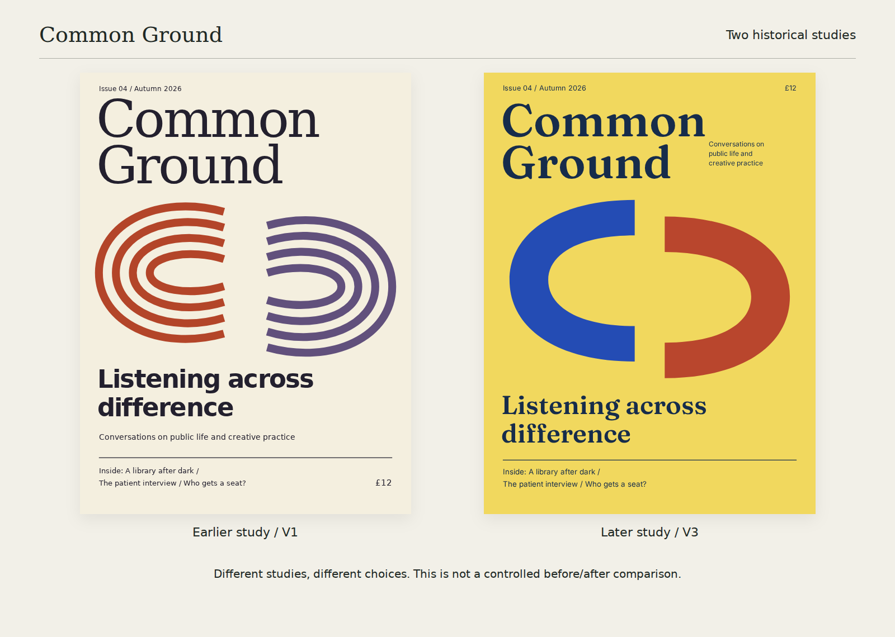
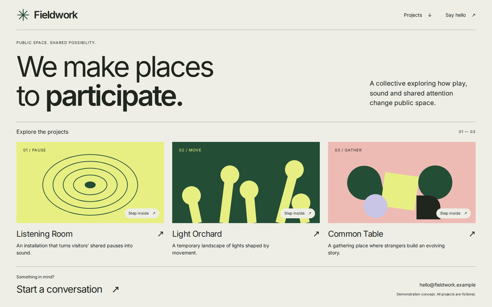
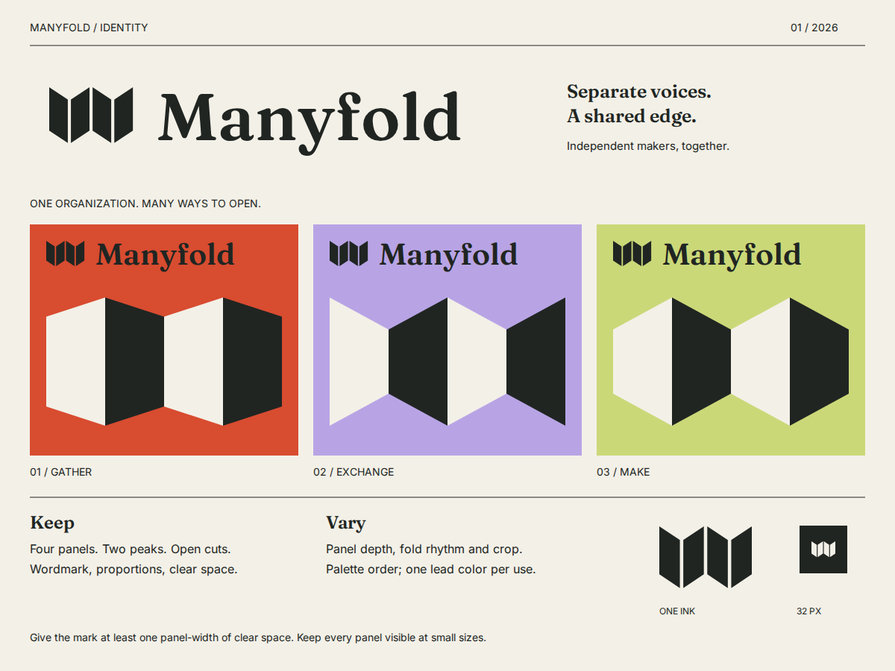

# Ingenium

**Turn a rough idea into a design you can keep working on.**

Explore distinct directions, refine the one you choose, and keep the editable files and decisions together. Ingenium is a creative skill for Codex and Claude, with a guided route for ChatGPT. Bring a poster, a website, an identity, a diagram—or an idea that is almost there.

[](https://ajhcs.github.io/Ingenium/#studies)

[Explore the live demos](https://ajhcs.github.io/Ingenium/) · [Editable sources](examples/release/README.md) · [Watch the walkthrough](https://ajhcs.github.io/Ingenium/#watch) · [Setup guide](docs/install.md)

- **Compare ideas you can react to.** Explore hierarchy, composition and character through useful studies.
- **Refine without starting over.** Keep the layout you chose while changing the title, spacing or another specific part.
- **Keep something useful.** Retain editable SVG, HTML or other source files, separate previews and a short account of the choices that matter.

## Start in your client

The creative guidance needs no Node runtime, server or API key of its own. Your client supplies the model and file tools. The optional terminal installer below uses Node/npm; [manual installation](docs/install.md#manual-install-without-node) does not.

### Codex app or CLI

Run in the project where you want to use Ingenium:

```sh
npx skills@1.7.2 add ajhcs/Ingenium --skill ingenium --agent codex
```

Open a fresh Codex conversation in that project, confirm Ingenium appears in the skill picker, and invoke **`$ingenium`** with your brief.

### Claude Code

Run in your project:

```sh
npx skills@1.7.2 add ajhcs/Ingenium --skill ingenium --agent claude-code
```

Start Claude Code there, check `/skills`, and use **`/ingenium`** with your brief. Both commands use the third-party [Vercel skills installer](https://github.com/vercel-labs/skills) and install project-local guidance. Review its prompt before confirming; it can replace an existing skill of the same name. See [update, remove and troubleshooting](docs/install.md#update-or-remove).

### ChatGPT

Without custom skill upload, copy the [Ingenium instructions](skills/ingenium/SKILL.md) into your conversation, then add your brief. If a named reference is needed, attach that file from the [guidance ZIP](https://github.com/ajhcs/Ingenium/raw/refs/heads/main/site/assets/downloads/ingenium-skill.zip). This uses the instructions in that conversation; it does not install a persistent skill.

If your workspace has custom Skills enabled, use **Plugins → Skills → Create → Upload from your computer**. Do not assume a personal Pro subscription includes this feature. See [workspace eligibility and setup](docs/install.md#chatgpt).

### Claude chat

[Download the guidance ZIP](https://github.com/ajhcs/Ingenium/raw/refs/heads/main/site/assets/downloads/ingenium-skill.zip), then go to **Customize → Skills → + → Create skill → Upload a skill**. Upload the ZIP, enable Ingenium and start a new chat with “Use Ingenium.” Code execution and file creation must be enabled. See [Claude chat setup](docs/install.md#claude-chat).

## Try it

After invoking the skill—or pasting its instructions—send:

> Make a poster for a fictional event called Evening Garden, on 24 May at 6 pm. The invitation is “An evening of listening, planting and conversation.” It should feel quiet and welcoming. Show two distinct organizing ideas as editable SVG files, keeping the wording the same. Use no image generation or external references. Preview the files if your tools allow it, and give me the actual files to open.

Then refine a choice:

> Keep the first study's layout and wording for this poster. Make only the title feel less formal. Save a new editable version and keep the previous files.

Ask for as much or as little as you need. A single study, a text comparison or a useful question can be enough. [Continue the first-study walkthrough](docs/quickstart.md).

## Made with Ingenium

Original fictional studies with editable sources:

| Publication | Website | Identity |
| --- | --- | --- |
| [](examples/release/cover/cover.svg) | [](https://ajhcs.github.io/Ingenium/studies/fieldwork/) | [](examples/release/identity/identity-sheet.svg) |
| [Cover source](examples/release/cover/cover.svg) | [Try the website](https://ajhcs.github.io/Ingenium/studies/fieldwork/) · [Source](examples/release/fieldwork/) | [Identity source](examples/release/identity/identity-sheet.svg) |

[Wayfinding and poster studies](examples/release/README.md) · [Download editable studies](https://ajhcs.github.io/Ingenium/assets/demos/editable-studies.zip) · [Preserved revisions](examples/progression/README.md)

## Optional local tools

The standalone skill and guidance ZIP contain instructions and references. For Ingenium's resource catalogs, record checks and SVG export, get the full repository separately:

```sh
git clone https://github.com/ajhcs/Ingenium.git
cd Ingenium
# Node 22+; Sharp is optional and used for PNG export.
npm ci --ignore-scripts
node bin/ingenium.mjs capabilities
```

[Generate an editable example](docs/quickstart.md#optional-make-an-editable-result-locally) · [Resource libraries](skills/ingenium/references/resource-libraries.md) · [Renderer setup](skills/ingenium/references/renderer-setup.md) · [Full user guide](docs/user-guide.md)

## Compatibility and status

Experimental **0.1.0**. Project-local Codex and Claude Code installation, guidance ZIP contents and local rendering have been checked. Actual client discovery and chat upload remain unverified here. Available formats and previews depend on your client's tools; a successful check does not decide taste or acceptance. [Installation evidence and limits](docs/onboarding-validation.md) · [Detailed validation](docs/validation.md) · [Immutable 0.1.0 preview release](https://github.com/ajhcs/Ingenium/releases/tag/v0.1.0).

Original code and artwork: [MIT](LICENSE). Third-party resources retain their [own notices](THIRD_PARTY_NOTICES.md). [Contributing interfaces](docs/contracts.md).
