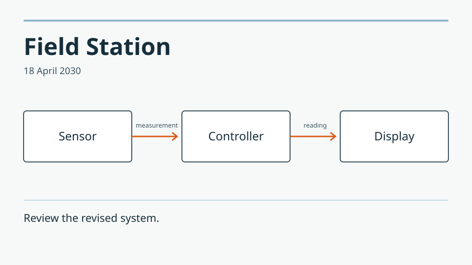

# Field Station

18 April 2030

Review the revised system.

## Overview

This view identifies the three elements and makes the direction of each connection explicit.

| Element | Role in this view |
| --- | --- |
| Sensor | Source of measurement |
| Controller | Receives measurement and sends reading |
| Display | Receives reading |

## Reference

Original synthetic [Field Station brief](../brief.json). The figure is illustrative, not a formal system model.
