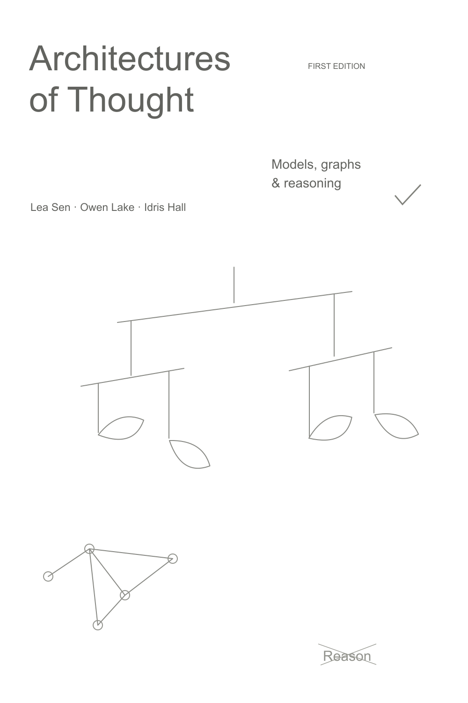
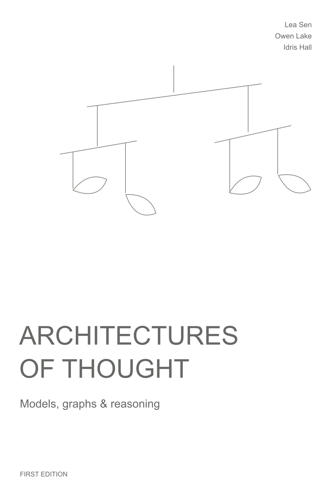
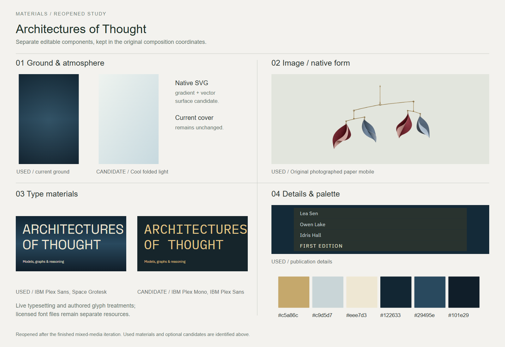
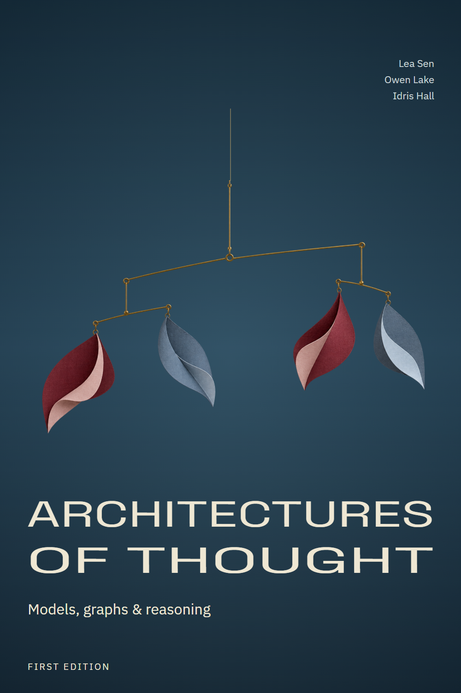

# Architectures of Thought

A textbook cover about models, graphs and reasoning, featuring a sculptural paper mobile.

[Back to the showcase](../../../README.md#thirteen-studies) · [Editable final](source/final-01.svg) · [Prompt record](prompts.json)

## Four views

### 01 · Ingredients

### 02 · Composition

### 03 · Asset studio

### 04 · Assembly and refinement

## Reusable stage prompts

These prompts were reconstructed from the study sources; they are not original transcripts.

| Stage | Reusable prompt |
| --- | --- |
| Ingredients | Gather the title, edition, authors and forms suggesting a balanced paper mobile. |
| Composition | Position the title and mobile in distinct fields with a clear reading order. |
| Asset studio | Develop an isolated paper-mobile image and choose an editorial type treatment. |
| Assembly and refinement | Combine the mobile and editable cover text; refine spacing and visual balance. |

## Asset provenance

Recorded image prompt

**Asset:** `thought-paper-mobile.png`

> Use case: product-mockup. Asset type: original sculptural paper-mobile photograph cutout for the upper image field of an elegant technical book cover; photograph of an object only, no typography. Create a real hand-assembled balanced hanging mobile with a slender warm-brass central vertical suspension, one long delicately tilted horizontal brass rod, two shorter branch rods hung beneath it, and exactly four curved folded-paper leaf forms at the ends. Two leaves are matte oxblood/burgundy with pale rose folded facets, two are muted slate-blue with pale blue folded facets. Sophisticated minimalist kinetic sculpture, actual thin paper edges and delicate fibers, small visible brass connection loops, physically plausible joints and gravity, asymmetrical but balanced. Front three-quarter product photograph, the entire hanging sculpture including top wire and all four paper leaves fully in frame. Soft gallery daylight, beautiful soft highlights and subtle photographic grain, tactile physical paper, very high detail. Isolated on a genuine transparent background, no plinth, no room, no text, no logos, no book/cover mockup, no watermark.

[Full prompt record](prompts.json)

The stages organize the work for review; they do not imply every artifact was produced in this order. The SVG contains editable layout and text; any embedded raster artwork remains raster.

## Editable materials

[Ingredient source](source/ingredients.svg) · [Composition source](source/composition-01.svg) · [Material board source](source/assets-board.svg) · [Reusable layer manifest](source/asset-kit/manifest.json) · [Font notices](../fonts/README.md)

Visual precedent: **Introduction to Algorithms — Third Edition**. Its visual approach informed this original study; reference artwork and source PDFs are not redistributed.
