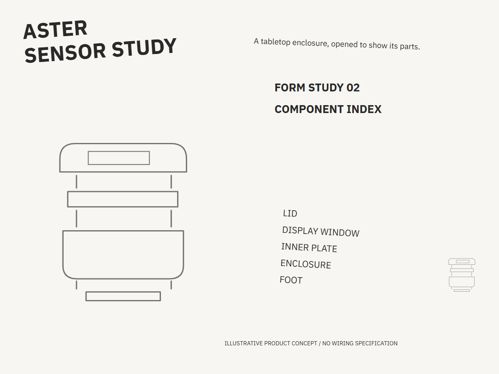
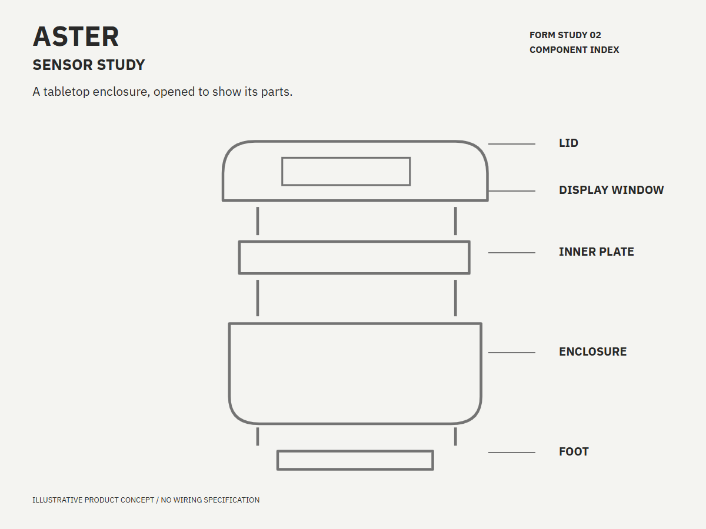
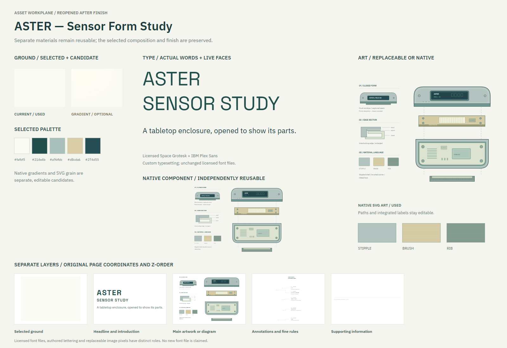
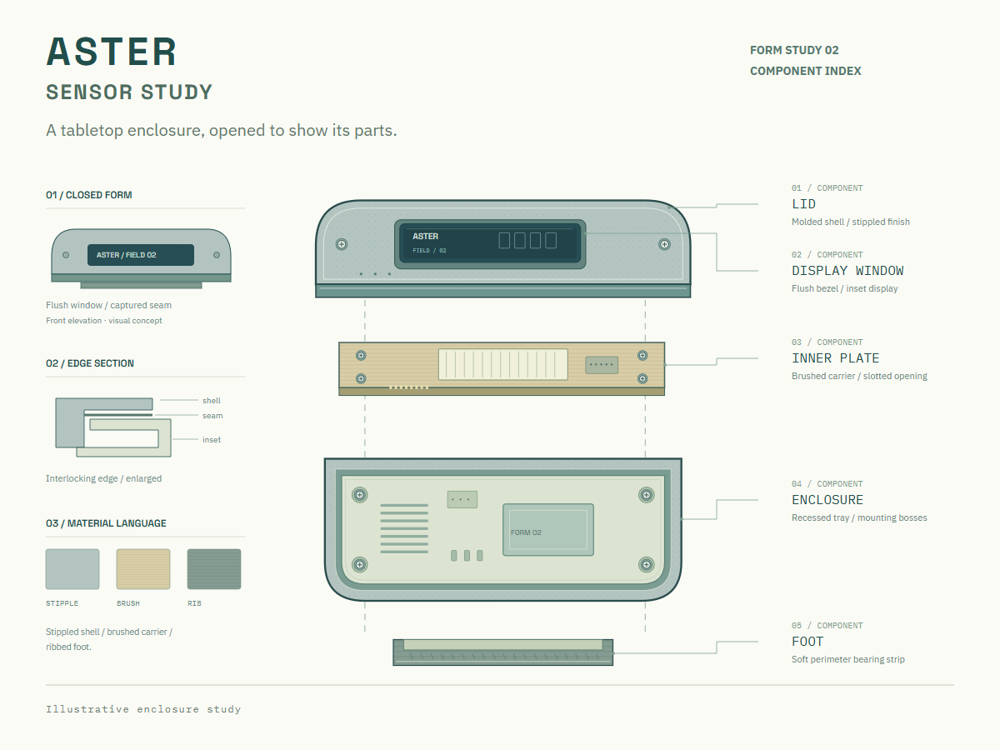

# ASTER

A fictional sensor enclosure study with an exploded assembly and component index.

[Back to the showcase](../../../README.md#thirteen-studies) · [Editable final](source/final-01.svg) · [Prompt record](prompts.json)

## Four views

### 01 · Ingredients

### 02 · Composition

### 03 · Asset studio

### 04 · Assembly and refinement

## Reusable stage prompts

These prompts were reconstructed from the study sources; they are not original transcripts.

| Stage | Reusable prompt |
| --- | --- |
| Ingredients | Gather the enclosure, lid, display window, inner plate, foot and component labels. |
| Composition | Arrange the rough enclosure illustration, component labels and title in a neutral hierarchy. |
| Asset studio | Draw editable enclosure components, surface textures and technical marks in SVG. |
| Assembly and refinement | Refine the exploded assembly and labels; add a closed form and enlarged edge section to the final study. |

## Asset provenance

The selected artwork is native vector; no image-generation prompt was recorded for it.

The stages organize the work for review; they do not imply every artifact was produced in this order. The SVG contains editable layout and text; any embedded raster artwork remains raster.

ASTER is an illustrative product concept; the study provides no wiring specification.

## Editable materials

[Ingredient source](source/ingredients.svg) · [Composition source](source/composition-01.svg) · [Material board source](source/assets-board.svg) · [Reusable layer manifest](source/asset-kit/manifest.json) · [Font notices](../fonts/README.md)

Visual precedent: **TRUPER Expert — Welder Parts and Connections**. Its visual approach informed this original study; reference artwork and source PDFs are not redistributed.
