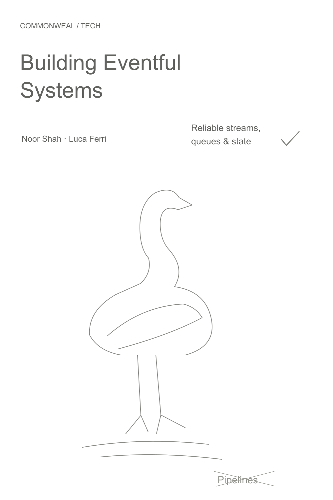
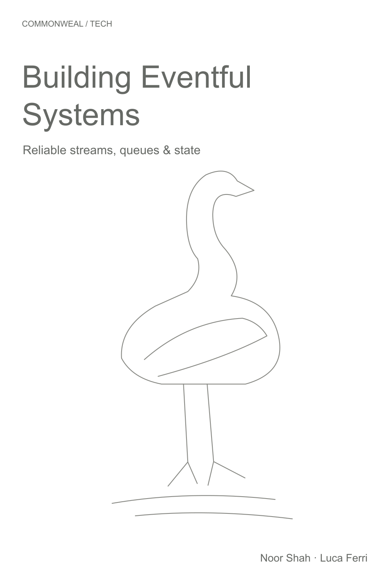
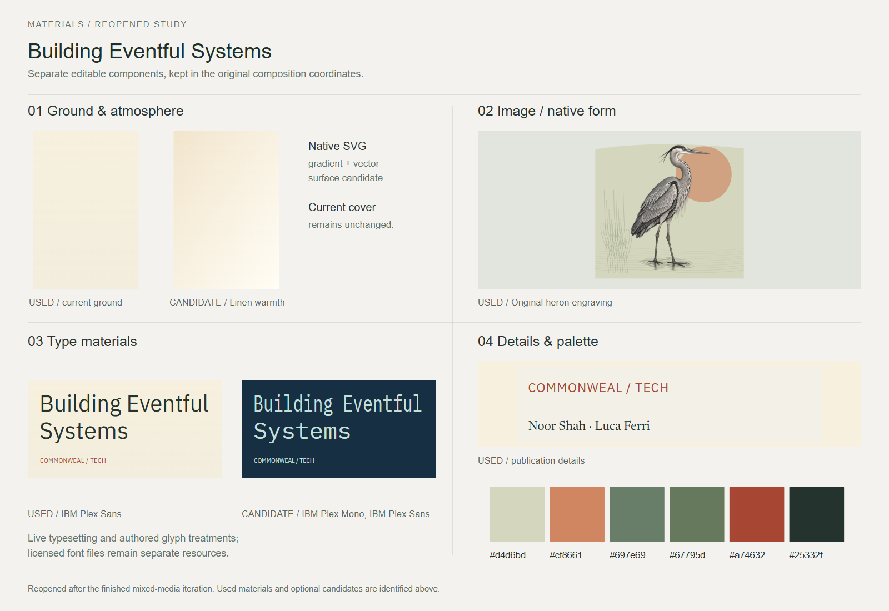
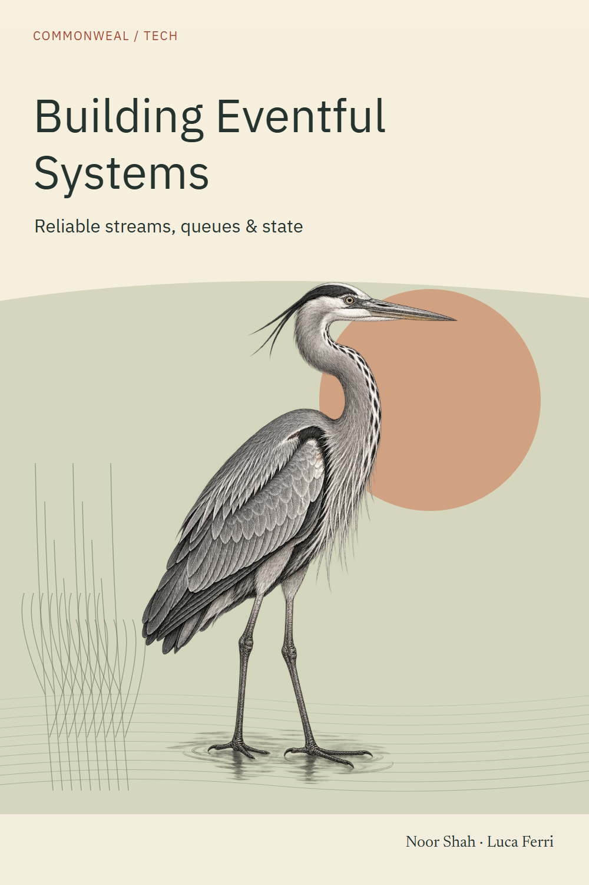

# Building Eventful Systems

A technical book cover about reliable streams, queues and state, paired with an engraving-style heron.

[Back to the showcase](../../../README.md#thirteen-studies) · [Editable final](source/final-01.svg) · [Prompt record](prompts.json)

## Four views

### 01 · Ingredients

### 02 · Composition

### 03 · Asset studio

### 04 · Assembly and refinement

## Reusable stage prompts

These prompts were reconstructed from the study sources; they are not original transcripts.

| Stage | Reusable prompt |
| --- | --- |
| Ingredients | Gather the title, subtitle, authors, heron and compact technical-book type. |
| Composition | Balance a compact title hierarchy against a tall bird illustration. |
| Asset studio | Develop an isolated engraving-style heron and select readable type. |
| Assembly and refinement | Assemble the cover and refine the relationship between the illustration and the book details. |

## Asset provenance

Recorded image prompt

**Asset:** `eventful-heron-engraving.png`

> Use case: illustration-story. Asset type: original engraving-style natural-history bird illustration for a technical book cover, illustration asset only. A tall grey heron standing in a shallow ripple of water, full elegant bird from crest to the complete long thin legs and toes, side profile facing right, anatomically plausible S-curved long neck and long straight pointed bill, calm attentive stance. Newly drawn in the tradition of an exceptionally fine copperplate natural-history engraving: thousands of delicate black ink hatch and cross-hatch marks, exquisite layered wing-feather detail, subtle stippled tonal transitions on the neck and breast, tiny precise eye, a few spare engraved water ripples beneath the feet. Primarily monochrome dark charcoal ink with restrained pale warm-grey shading. Genuine transparent background, crisp isolated silhouette, no rectangular paper sheet, no frame. Leave comfortable breathing room around the entire bird; do not crop feet, bill or crest. No labels, words, scientific captions, numbers, logos, signatures or watermark. Entirely original drawing, not a reproduction of an antique plate.

[Full prompt record](prompts.json)

The stages organize the work for review; they do not imply every artifact was produced in this order. The SVG contains editable layout and text; any embedded raster artwork remains raster.

## Editable materials

[Ingredient source](source/ingredients.svg) · [Composition source](source/composition-01.svg) · [Material board source](source/assets-board.svg) · [Reusable layer manifest](source/asset-kit/manifest.json) · [Font notices](../fonts/README.md)

Visual precedent: **Designing Data-Intensive Applications — 2nd Edition**. Its visual approach informed this original study; reference artwork and source PDFs are not redistributed.
