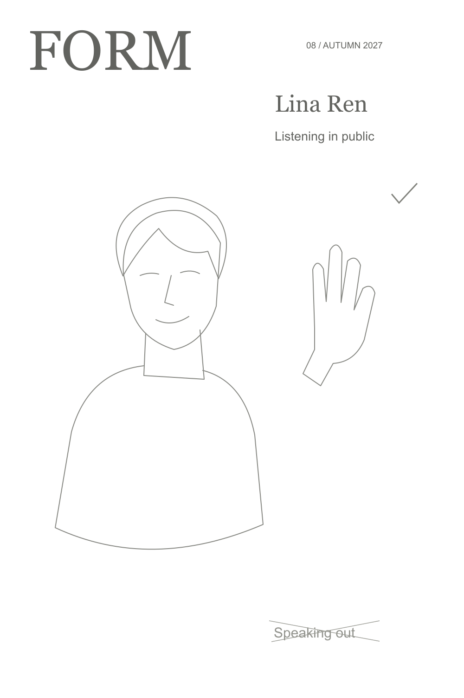
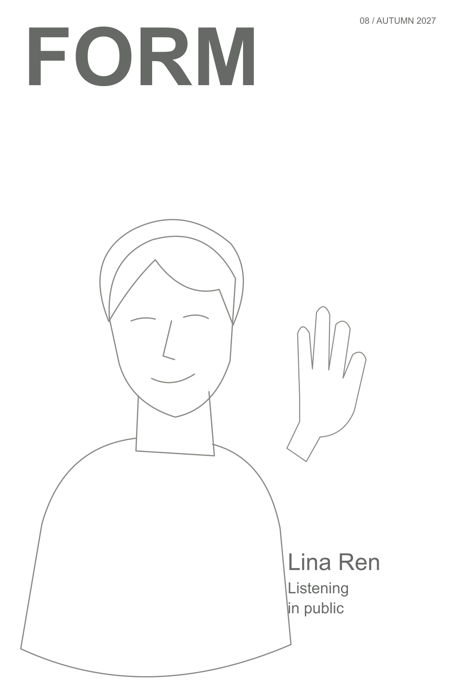
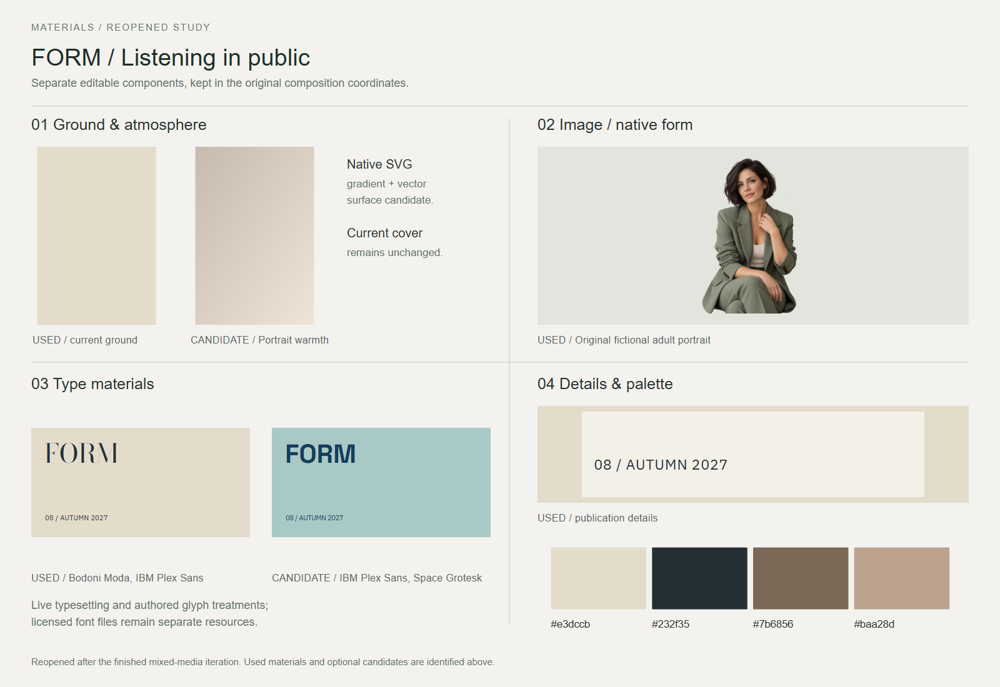
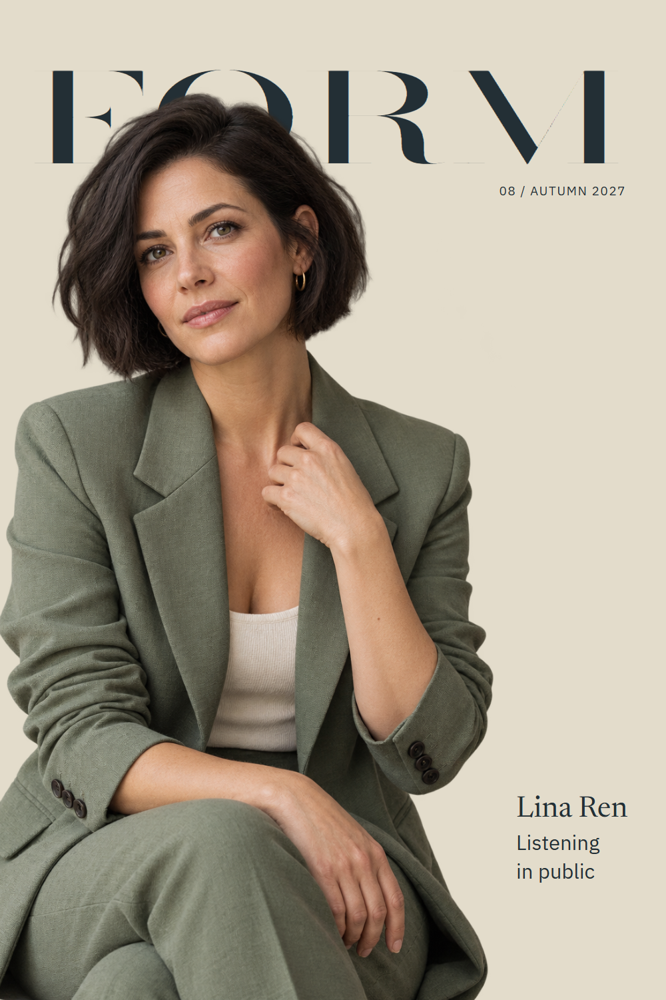

# FORM 08

A fictional culture magazine issue on listening in public.

[Back to the showcase](../../../README.md#thirteen-studies) · [Editable final](source/final-01.svg) · [Prompt record](prompts.json)

## Four views

### 01 · Ingredients

Rough components to select and combine.

### 02 · Composition

A neutral placement study for hierarchy and grouping.

### 03 · Asset studio

The visual assets and treatments considered for the assembly.

### 04 · Assembly and refinement

The selected design brought together for inspection and revision.

## Reusable stage prompts

These prompts were reconstructed from the study sources; they are not original transcripts.

| Stage | Reusable prompt |
| --- | --- |
| Ingredients | Collect the FORM masthead, issue information, listening coverline and portrait direction. |
| Composition | Test the masthead, coverline and portrait as a clear magazine hierarchy. |
| Asset studio | Develop a fictional editorial portrait and select supporting typography. |
| Assembly and refinement | Assemble the cover and refine depth, portrait placement and readable type. |

## Asset provenance

Recorded image prompt

**Asset 1:** `form-portrait.png`

> Use case: photorealistic-natural. Asset type: original editorial portrait cutout for a culture-magazine cover, photography asset only, no typography. Primary request: create an entirely fictional adult woman in her late thirties with a short dark bob and a thoughtful, quietly confident expression, wearing a beautifully tailored desaturated sage-green jacket over a natural ivory top. Three-quarter seated portrait, head through upper thighs, torso angled gently toward camera, one hand resting naturally near the collar/upper chest as if listening to someone off camera; complete anatomically natural hands, no floating separate hand. Beautiful face with natural skin detail, tiny pores, faint smile lines; no beauty retouch plastic. Premium independent-magazine portrait photography, medium-format film feel, soft large north-window light from camera left, very gentle shadow, subtle warm fine grain. Composition: tall portrait, subject occupies most of the asset height, head with comfortable top breathing room, shoulders and elbows intact, calm sculptural pose, minimal accessories. Isolated on a genuinely transparent background, clean natural hair edges. No text, no logos, no watermark, no frame, no magazine mockup, no copied identity or recognizable celebrity.

[Full prompt record](prompts.json)

The stages organize the work for review; they do not imply every artifact was produced in this order. The SVG contains editable layout and text; any embedded raster artwork remains raster.

## Editable materials

[Ingredient source](source/ingredients.svg) · [Composition source](source/composition-01.svg) · [Material board source](source/assets-board.svg) · [Reusable layer manifest](source/asset-kit/manifest.json) · [Font notices](../fonts/README.md)

Visual precedent: **Port 35 — Colman Domingo**. Its visual approach informed this original study; reference artwork and source PDFs are not redistributed.
