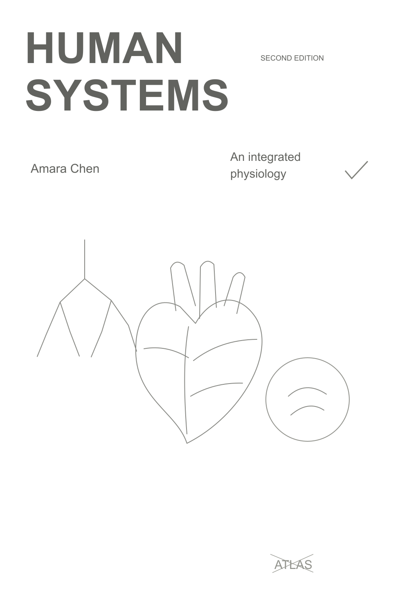
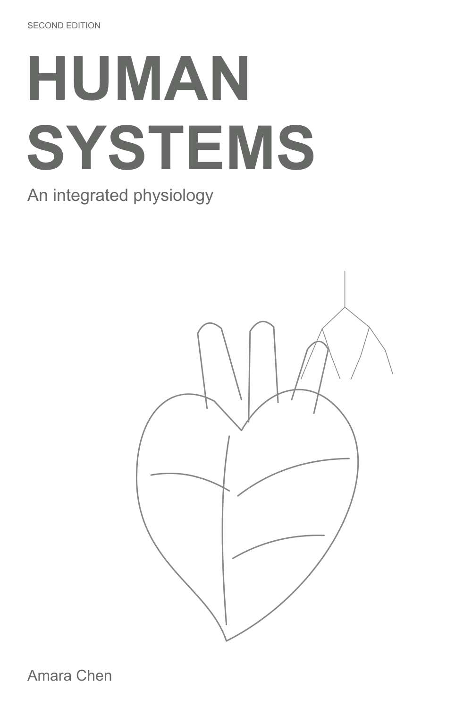
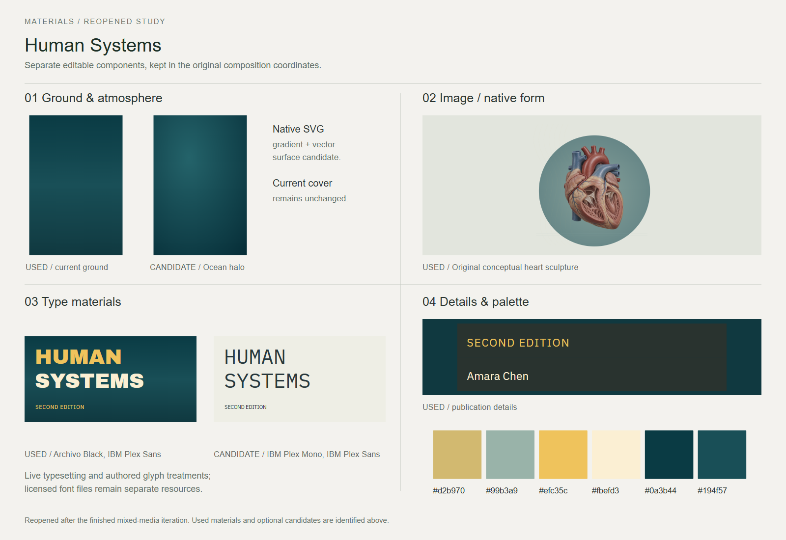
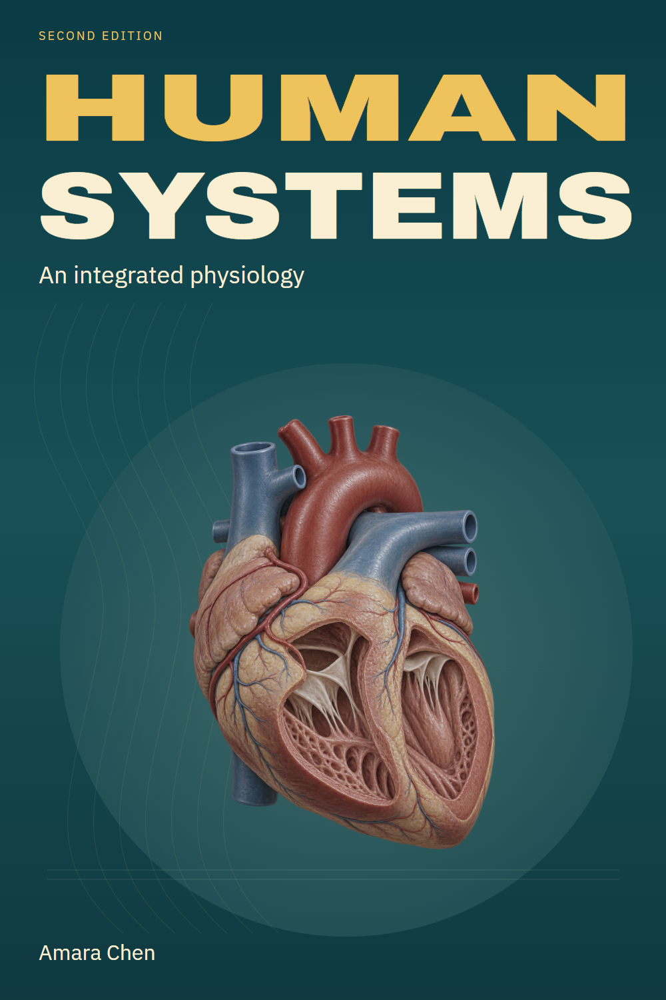

# Human Systems

A physiology textbook cover featuring a conceptual heart teaching model.

[Back to the showcase](../../../README.md#thirteen-studies) · [Editable final](source/final-01.svg) · [Prompt record](prompts.json)

## Four views

### 01 · Ingredients

### 02 · Composition

### 03 · Asset studio

### 04 · Assembly and refinement

## Reusable stage prompts

These prompts were reconstructed from the study sources; they are not original transcripts.

| Stage | Reusable prompt |
| --- | --- |
| Ingredients | Gather the title, subtitle, author, edition and a heart-model concept. |
| Composition | Arrange the title and central heart image for an educational cover. |
| Asset studio | Develop an isolated conceptual teaching-model illustration and select the cover typography. |
| Assembly and refinement | Assemble the image and editable type; refine their scale and hierarchy. |

## Asset provenance

Recorded image prompt

**Asset:** `human-heart-model.png`

> Use case: scientific-educational. Asset type: original sculptural educational illustration cutout for a physiology textbook cover, artwork only, no labels or typography. Create a beautifully crafted, anatomically convincing human-heart teaching model, three-quarter anterior view, with one restrained cutaway window into the ventricles so muscular chamber structure can be appreciated. It should look like a sophisticated hand-painted wax/resin museum teaching model photographed in soft studio light, tactile matte surfaces and subtle sculptural tool marks, warm terracotta and muted coral myocardium, deep red major arteries, restrained blue venous vessels, tiny precise surface coronary vessels. Complete heart and major superior vessels fully in frame, centered with generous breathing room. Educational and elegant, no blood, wounds, gore or surgical scene. Genuine transparent background, natural soft edge shadows only. No letters, diagrams, numbers, arrows, captions, titles, branding, logos, watermark, tabletop or surrounding room. This is a newly created conceptual cover illustration, not a diagnostic image or replica of a specific existing museum model.

[Full prompt record](prompts.json)

The stages organize the work for review; they do not imply every artifact was produced in this order. The SVG contains editable layout and text; any embedded raster artwork remains raster.

The heart is conceptual cover art, not an anatomical atlas or diagnostic image.

## Editable materials

[Ingredient source](source/ingredients.svg) · [Composition source](source/composition-01.svg) · [Material board source](source/assets-board.svg) · [Reusable layer manifest](source/asset-kit/manifest.json) · [Font notices](../fonts/README.md)

Visual precedent: **Physiology — The Big Picture, 3rd Edition**. Its visual approach informed this original study; reference artwork and source PDFs are not redistributed.
