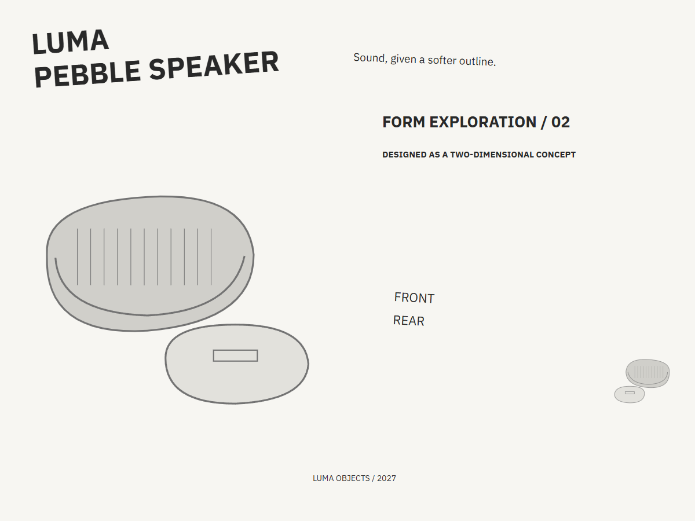
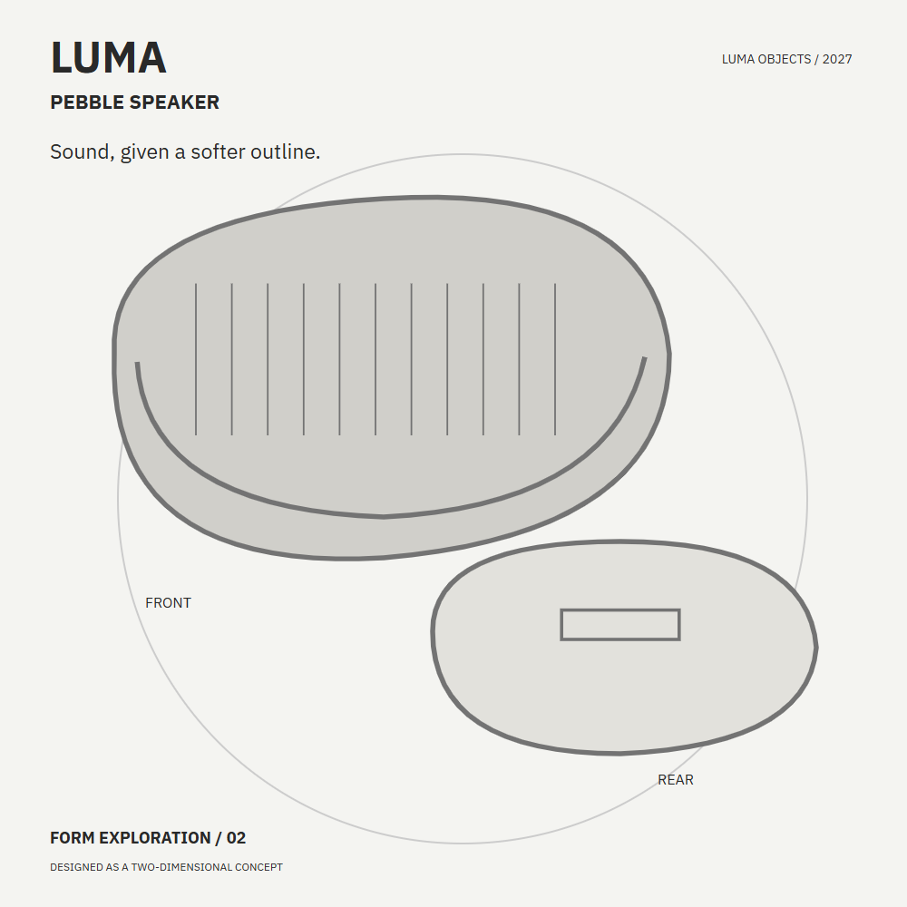
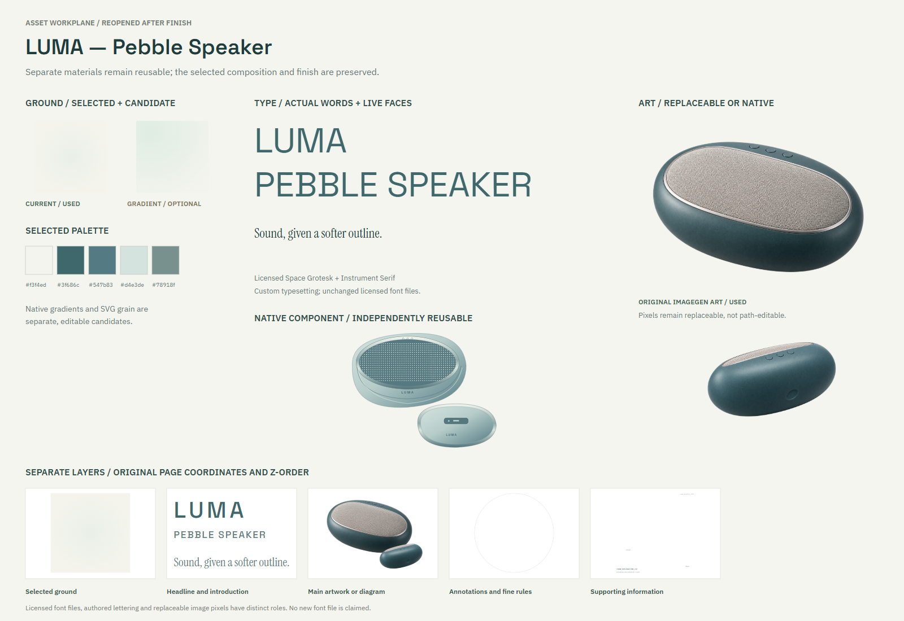
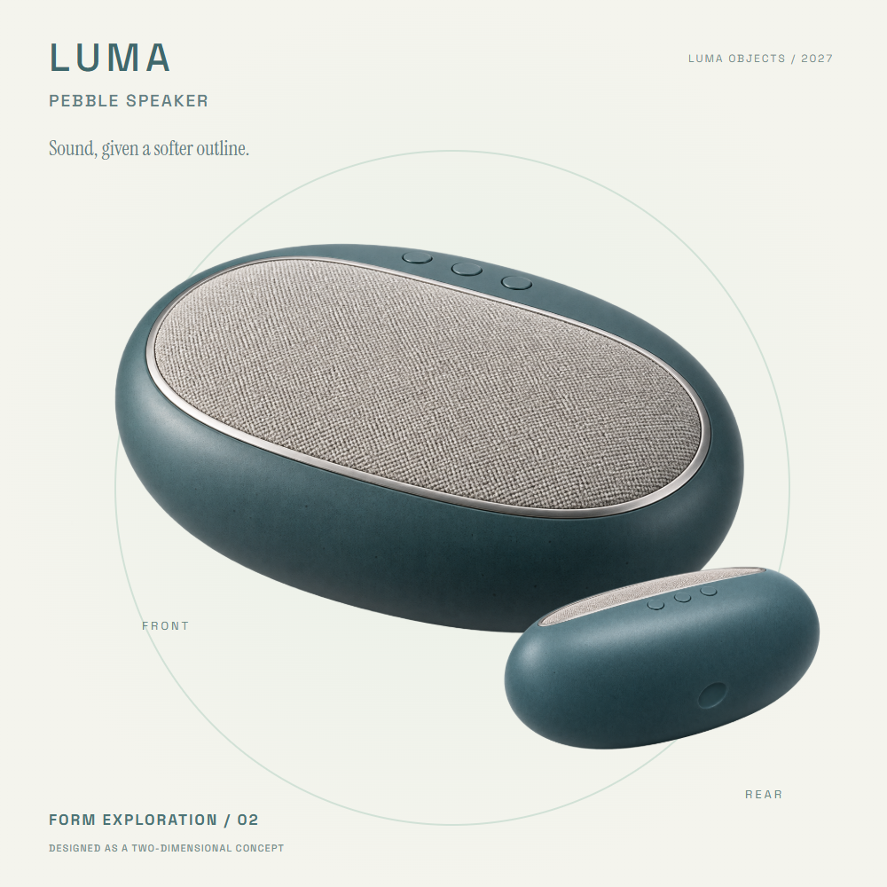

# LUMA

A two-dimensional product-hero concept for a fictional pebble speaker.

[Back to the showcase](../../../README.md#nine-studies) · [Editable final](source/final-01.svg) · [Prompt record](prompts.json)

## Four views

### 01 · Ingredients

Rough components to select and combine.

### 02 · Composition

A neutral placement study for hierarchy and grouping.

### 03 · Asset studio

The visual assets and treatments considered for the assembly.

### 04 · Assembly and refinement

The selected design brought together for inspection and revision.

## Reusable stage prompts

These prompts were reconstructed from the study sources; they are not original transcripts.

| Stage | Reusable prompt |
| --- | --- |
| Ingredients | Gather the product name, short introduction, front and rear views and a restrained palette. |
| Composition | Arrange the primary product view, secondary view and labels as a product hero. |
| Asset studio | Develop isolated front and rear speaker images and choose legible supporting type. |
| Assembly and refinement | Assemble the two-dimensional concept and refine the emphasis of the product views. |

## Asset provenance

Recorded image prompts

**Asset 1:** `luma-front-v1.png`

> Use case: product-mockup. Asset type: one original product photograph cutout to place inside an editable SVG product-design study; generate only the object, not a poster, no typography. Subject: an invented LUMA pebble speaker concept, a palm-sized horizontal river-stone shaped object, softly flattened oval form with an asymmetrical but calm rounded silhouette. Premium tactile matte desaturated petrol-teal ceramic-like shell, a broad inset warm pale-gray finely woven acoustic grille on the upward-facing front, a hairline satin-aluminium lip around the grille, three tiny flush unmarked round buttons at the top edge. Convincing material grain, edge highlights and delicate join lines; restrained Scandinavian industrial design, entirely original and not based on an existing commercial product. Camera: three-quarter view from slightly above and to the left, showing the front grille and curved lower shell; the long axis is horizontal, whole object comfortably inside frame with 12 percent transparent breathing room. Lighting: very large soft studio key, gentle warm bounce, physically believable surface detail and mild reflections, premium editorial product photography, crisp but not over-sharpened. Background: genuinely transparent alpha, no floor, no scenery; a very faint soft contact shadow is optional but must stay within alpha. Constraints: exactly one closed object. No text, no logos, no lettering, no dimension arrows, no invented engineering labels, no hands, no decorative props, no platform, no second object, no exploded internal components. This is a visual concept, not a validated engineered product.

**Asset 2:** `luma-rear-v1.png`

> Use case: precise-object-edit / product-mockup. Asset type: a second-angle isolated product photograph for an editable SVG product study. The input image is the identity reference for the invented pebble-shaped speaker concept. Preserve its same softly flattened oval shell, desaturated petrol-teal fine-grain matte finish, hairline satin aluminium rim and scale of three flush unmarked buttons. Create a rear three-quarter view of the same object, with camera slightly above from the opposite side. The front grille should be mostly turned away, with only a slim hint of the pale woven surface at the upper edge. The visible rear shell is quiet and sculptural, with one small shallow unmarked rounded recess, no lettering and no elaborate functional detail. Long axis horizontal; one complete object centered with generous 15 percent clear padding. Match the previous very soft studio key, warm bounce and premium tactile editorial realism. Genuine transparent alpha background. No text, no logo, no watermark, no hands, no extra objects, no platform, no engineering labels or claims, no exploded parts. This is a 2D visual concept, not a validated manufactured product.

[Full prompt record](prompts.json)

The stages organize the work for review; they do not imply every artifact was produced in this order. The SVG contains editable layout and text; any embedded raster artwork remains raster.

LUMA is a visual concept, not a validated engineered product.

## Editable materials

[Ingredient source](source/ingredients.svg) · [Composition source](source/composition-01.svg) · [Material board source](source/assets-board.svg) · [Reusable layer manifest](source/asset-kit/manifest.json) · [Font notices](../fonts/README.md)

Visual precedent: **YA-MAN — Floating Device Product Hero**. Its visual approach informed this original study; reference artwork and source PDFs are not redistributed.
