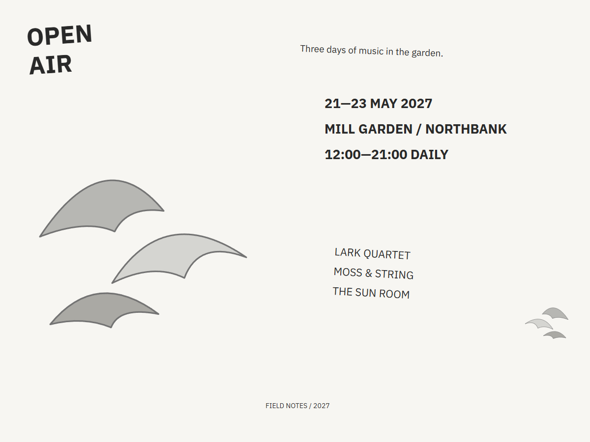
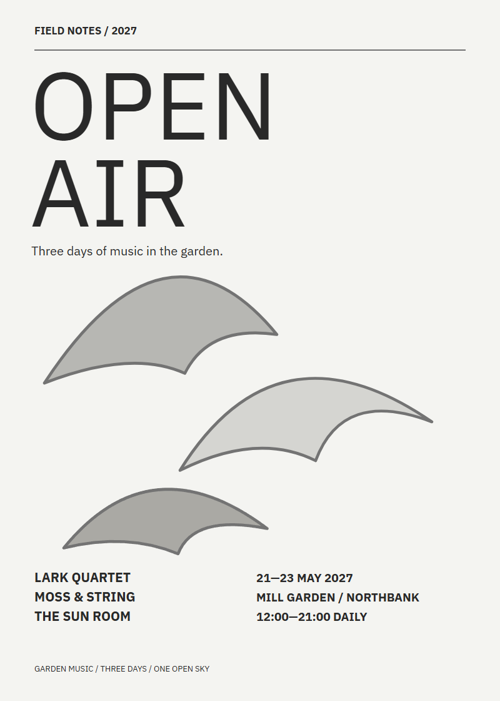
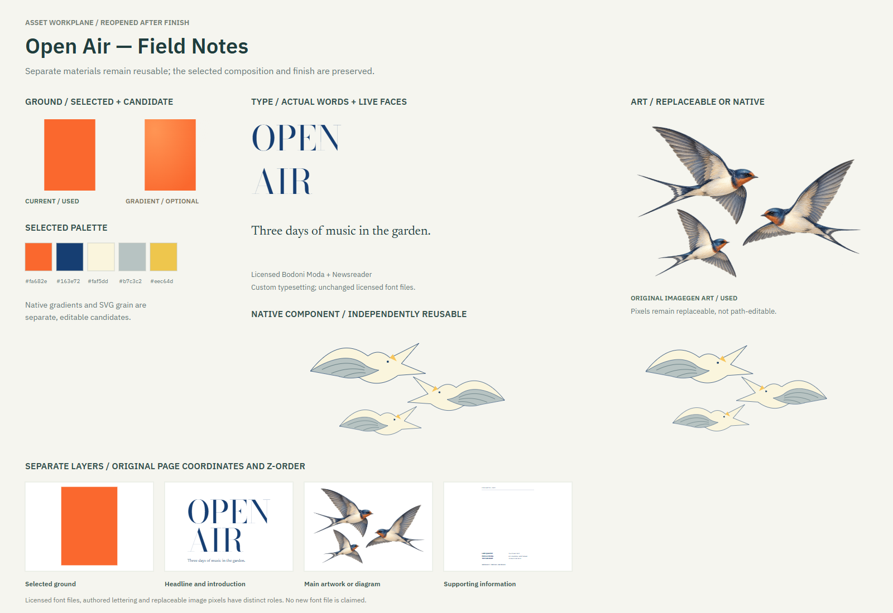
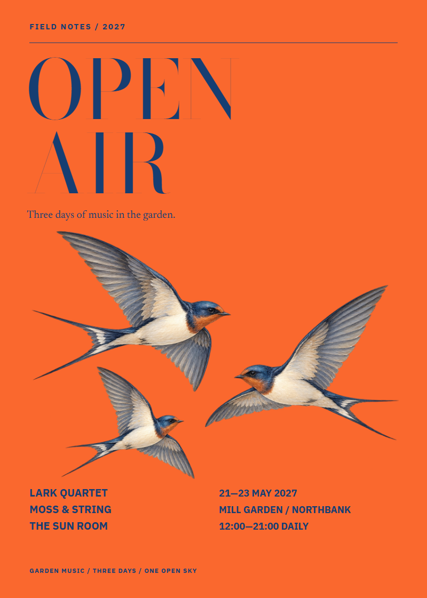

# Open Air

A fictional garden-music festival poster with three painted swallows.

[Back to the showcase](../../../README.md#thirteen-studies) · [Editable final](source/final-01.svg) · [Prompt record](prompts.json)

## Four views

### 01 · Ingredients

Rough components to select and combine.

### 02 · Composition

A neutral placement study for hierarchy and grouping.

### 03 · Asset studio

The visual assets and treatments considered for the assembly.

### 04 · Assembly and refinement

The selected design brought together for inspection and revision.

## Reusable stage prompts

These prompts were reconstructed from the study sources; they are not original transcripts.

| Stage | Reusable prompt |
| --- | --- |
| Ingredients | Collect the event name, dates, venue, performer names and swallow motifs. |
| Composition | Arrange the event information around an airy central illustration. |
| Asset studio | Develop three painted swallows and select typography for the event details. |
| Assembly and refinement | Combine the birds and live type; refine spacing and the reading order. |

## Asset provenance

Recorded image prompt

**Asset 1:** `swallows-gouache-v1.png`

> Use case: illustration-story. Asset type: original bird-illustration artwork for the central field of a garden-music poster; the poster typography and colored background will be built separately in editable SVG. Generate exactly three graceful swallows in flight, no scenery. Arrange them as an airy horizontal diagonal group: one larger swallow at upper left banking toward the right, one at center right gliding left, one smaller at lower left. Keep their complete silhouettes separate with generous clear gaps. Style: finely painted gouache and colored-pencil editorial natural-history illustration, warm ivory breast, cool mist-blue and slate-gray upper wings, a restrained dark navy eye and slender beak, delicate layered feather brushmarks and subtle handmade paper texture. Lyrical and light rather than cartoonish; convincing wing anatomy and forked tails, but elegant simplified shapes suit a cultural festival poster. Soft, consistent illumination and crisp cutout contours. Genuine transparent alpha background everywhere outside the birds. No branches, no landscape, no sky, no frame, no lettering, no logos, no text, no border, no fourth bird. Entirely original imagery, not a reproduction of any referenced poster. This is a visual illustration asset only.

[Full prompt record](prompts.json)

The stages organize the work for review; they do not imply every artifact was produced in this order. The SVG contains editable layout and text; any embedded raster artwork remains raster.

## Editable materials

[Ingredient source](source/ingredients.svg) · [Composition source](source/composition-01.svg) · [Material board source](source/assets-board.svg) · [Reusable layer manifest](source/asset-kit/manifest.json) · [Font notices](../fonts/README.md)

Visual precedent: **Exil — Mizmorim chamber music festival**. Its visual approach informed this original study; reference artwork and source PDFs are not redistributed.
