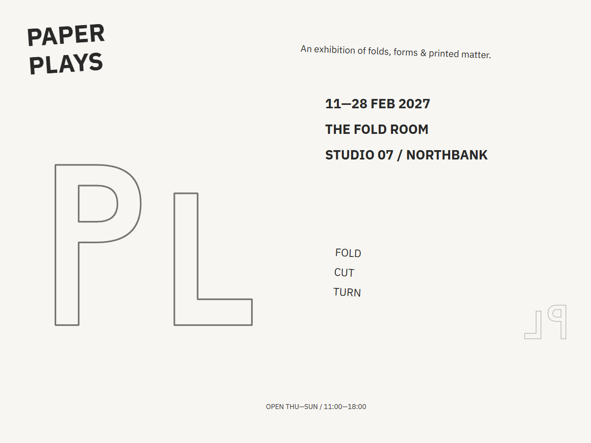
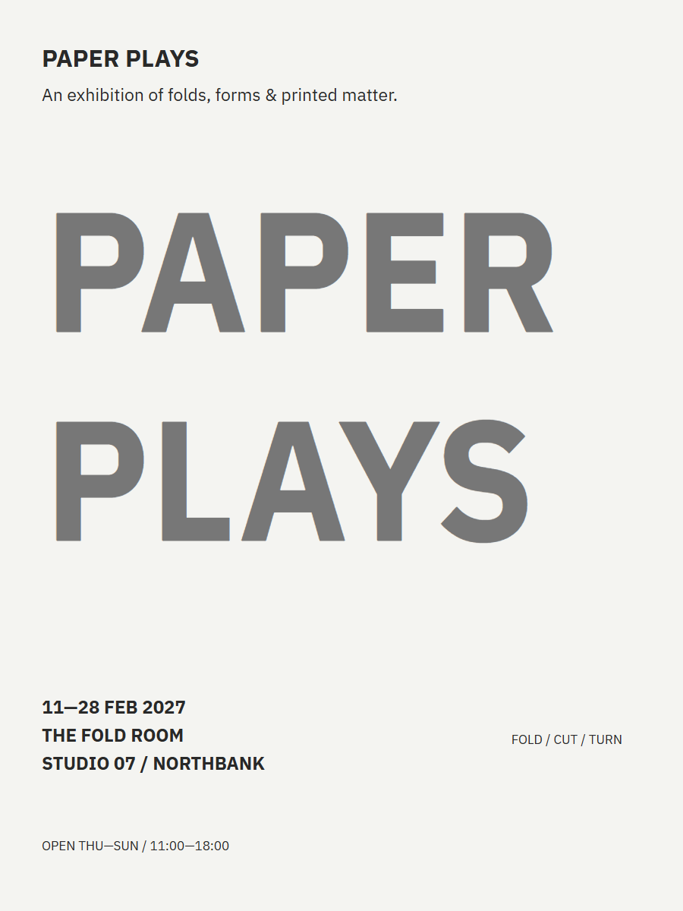
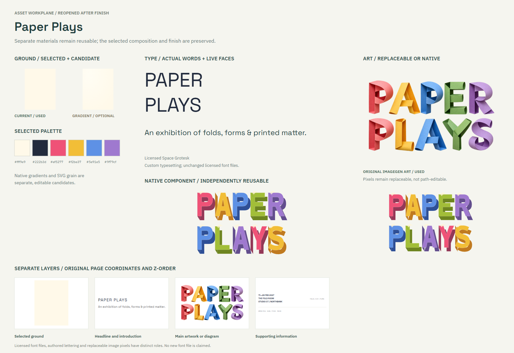
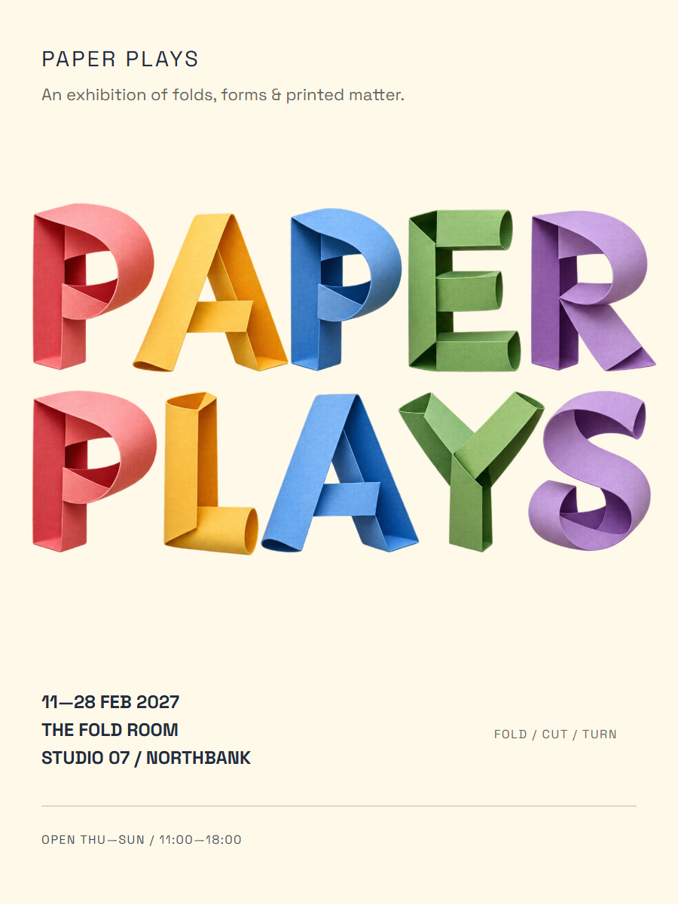

# Paper Plays

An exhibition poster with sculptural folded-paper lettering.

[Back to the showcase](../../../README.md#nine-studies) · [Editable final](source/final-01.svg) · [Prompt record](prompts.json)

## Four views

### 01 · Ingredients

Rough components to select and combine.

### 02 · Composition

A neutral placement study for hierarchy and grouping.

### 03 · Asset studio

The visual assets and treatments considered for the assembly.

### 04 · Assembly and refinement

The selected design brought together for inspection and revision.

## Reusable stage prompts

These prompts were reconstructed from the study sources; they are not original transcripts.

| Stage | Reusable prompt |
| --- | --- |
| Ingredients | Collect the exhibition name, venue, dates, paper forms and vivid colors. |
| Composition | Position the sculptural title and event details as a readable poster. |
| Asset studio | Develop folded-paper lettering artwork and choose clear supporting typography. |
| Assembly and refinement | Assemble the artwork and live type; simplify the typography and refine spacing. |

## Asset provenance

Recorded image prompt

**Asset 1:** `paper-sculpture-v1.png`

> Use case: stylized-concept / product-mockup. Asset type: a photographed physical paper-letter sculpture to be placed as a replaceable artwork asset within an editable exhibition-poster SVG. Generate the sculpture only, not a finished poster. Subject: two carefully aligned rows of original sculptural letters made by folding and curling thick colored paper, spelling exactly PAPER on the first row and PLAYS on the second row. Text, verbatim: PAPER / PLAYS. Five letters in each row. Letters must remain immediately readable, with clear counters and complete silhouettes. Invent the letter construction rather than imitating a known typeface: broad paper bands, folded returns, occasional rolled edges, visible paper thickness and believable joins. Letter colors move across coral-pink, saffron yellow, cornflower blue, leaf green and lilac, with each letter a distinct sheet color and a darker folded reverse. Subtle fibrous paper texture, crisp physical cut edges and soft tiny self-shadows. Camera: near-frontal with a small above-right perspective so folded depth is visible; both rows have a level baseline; generous transparent padding around all letters, no letter touching the frame. Lighting: diffuse bright tabletop studio light, gentle warm bounce, refined museum design-photography quality. Genuine transparent alpha background, no tabletop or cast shadow plane. No other words, no captions, no logos, no border, no graphic poster background, no people, no tools or props. Original physical lettering artwork only.

[Full prompt record](prompts.json)

The stages organize the work for review; they do not imply every artifact was produced in this order. The SVG contains editable layout and text; any embedded raster artwork remains raster.

## Editable materials

[Ingredient source](source/ingredients.svg) · [Composition source](source/composition-01.svg) · [Material board source](source/assets-board.svg) · [Reusable layer manifest](source/asset-kit/manifest.json) · [Font notices](../fonts/README.md)

Visual precedent: **Plakatszene Luzern — folded poster ribbons**. Its visual approach informed this original study; reference artwork and source PDFs are not redistributed.
