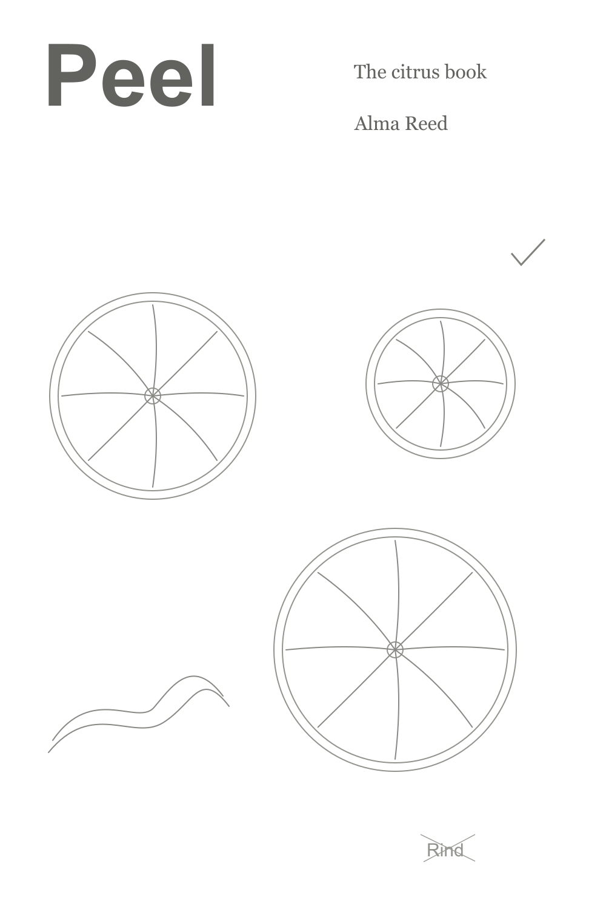
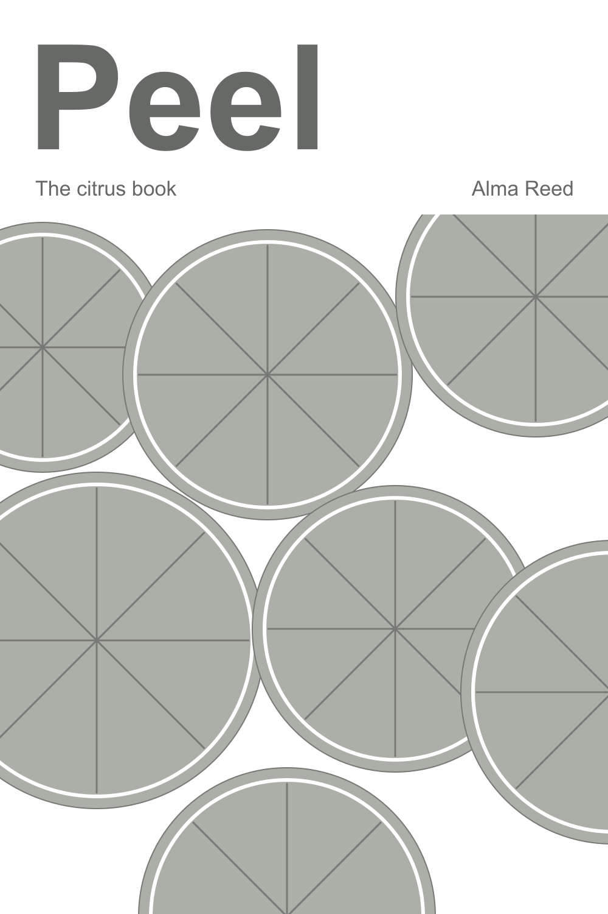
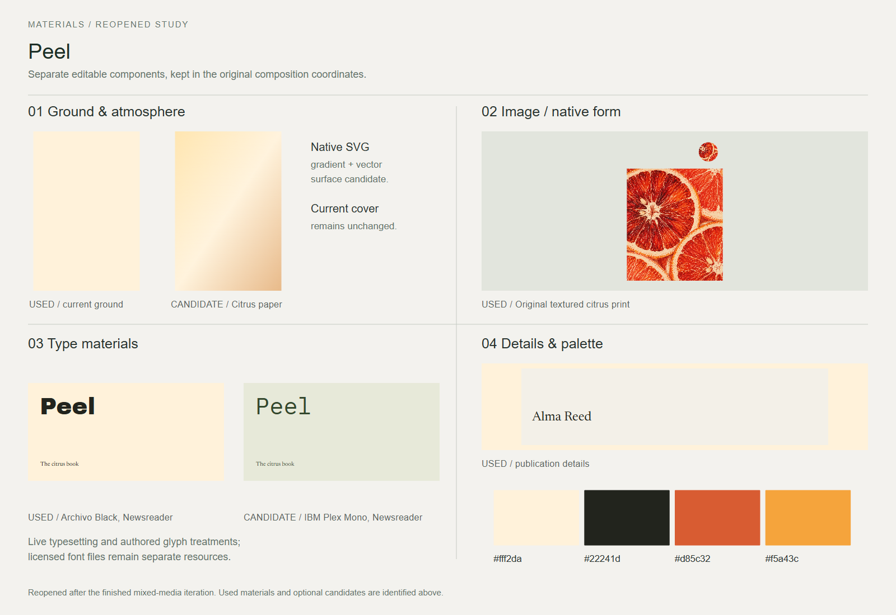
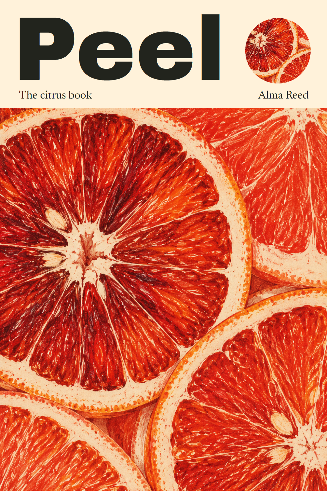

# Peel

A food monograph pairing a bold title with textured citrus imagery.

[Back to the showcase](../../../README.md#nine-studies) · [Editable final](source/final-01.svg) · [Prompt record](prompts.json)

## Four views

### 01 · Ingredients

Rough components to select and combine.

### 02 · Composition

A neutral placement study for hierarchy and grouping.

### 03 · Asset studio

The visual assets and treatments considered for the assembly.

### 04 · Assembly and refinement

The selected design brought together for inspection and revision.

## Reusable stage prompts

These prompts were reconstructed from the study sources; they are not original transcripts.

| Stage | Reusable prompt |
| --- | --- |
| Ingredients | Collect the title, author, citrus forms and a warm red-and-cream palette as separate ingredients. |
| Composition | Place the large title above an image field; test the balance between lettering and fruit. |
| Asset studio | Develop a textured citrus illustration and choose type that can hold its own against it. |
| Assembly and refinement | Combine the artwork and editable type; refine the title width and the density of the cover. |

## Asset provenance

Recorded image prompt

**Asset 1:** `peel-citrus-texture.png`

> Use case: stylized-concept. Asset type: original finely textured citrus illustration for the image panel of an artful food book. An extreme close-up composition of several sliced blood oranges and grapefruit cross-sections, packed and cropped boldly at the edges. Exquisite organic citrus anatomy: uneven translucent juice vesicles, irregular segments, tiny seeds, thick pale pith and thin rind. It must feel tactile and finely observed rather than perfect repeated vector circles. Medium: a contemporary hand-printed botanical food illustration combining dense colored-pencil and gouache detail with slightly broken two-ink screenprint texture on warm uncoated cream paper. Restrict the colors to vivid vermilion/orange-red and warm cream, with subtle pigment variation, paper tooth, sharp fibrous detail. Full-bleed portrait-oriented art asset, no tabletop props, no surrounding room, no words, no title, no author, no logos or watermark, no book or poster mockup. Entirely original composition.

[Full prompt record](prompts.json)

The stages organize the work for review; they do not imply every artifact was produced in this order. The SVG contains editable layout and text; any embedded raster artwork remains raster.

## Editable materials

[Ingredient source](source/ingredients.svg) · [Composition source](source/composition-01.svg) · [Material board source](source/assets-board.svg) · [Reusable layer manifest](source/asset-kit/manifest.json) · [Font notices](../fonts/README.md)

Visual precedent: **Steak — The Whole Story**. Its visual approach informed this original study; reference artwork and source PDFs are not redistributed.
