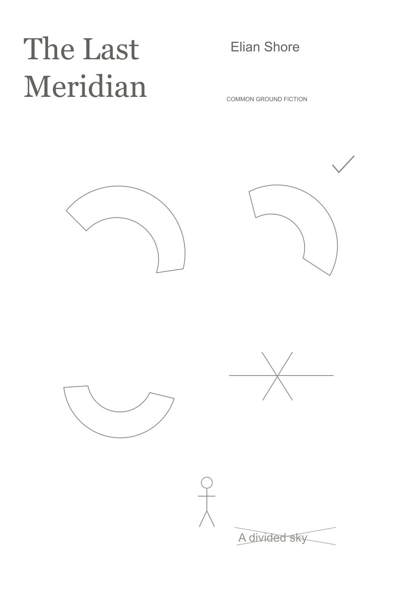
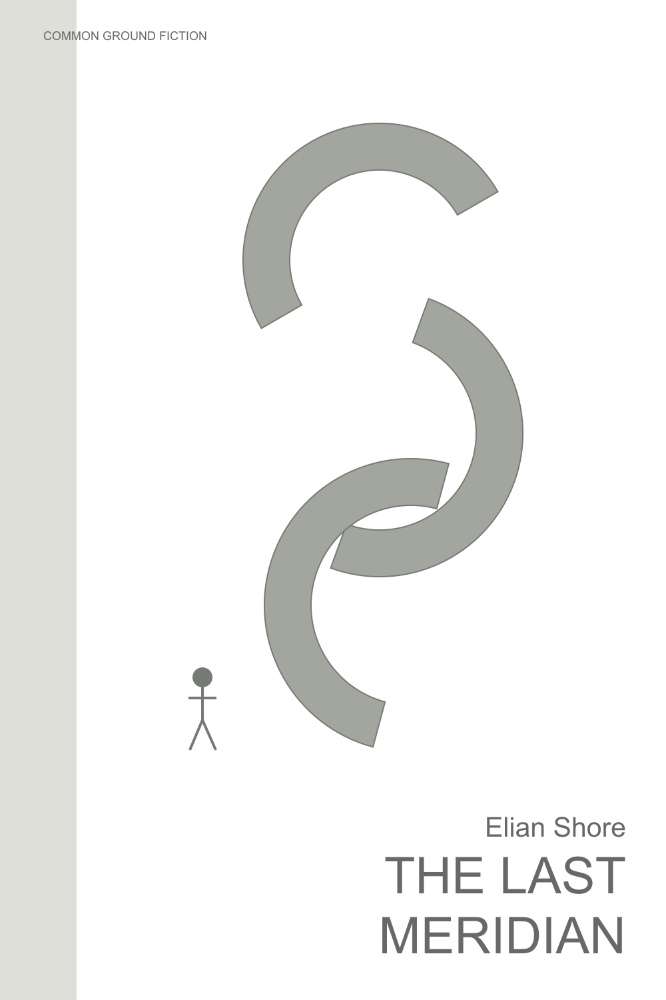
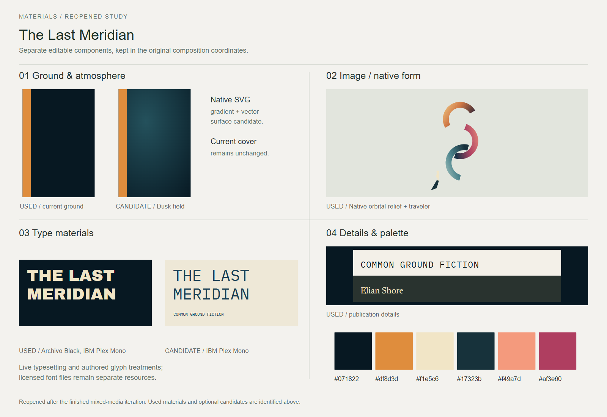
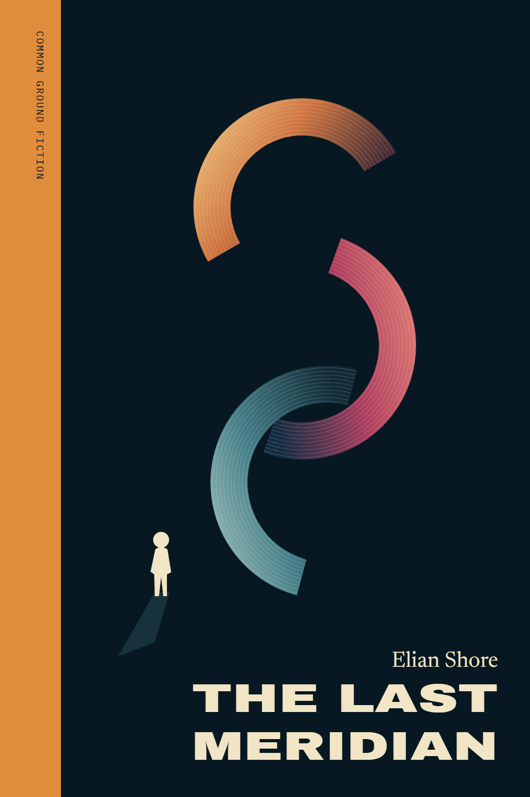

# The Last Meridian

A speculative-fiction cover for a traveler crossing a divided world.

[Back to the showcase](../../../README.md#nine-studies) · [Editable final](source/final-01.svg) · [Prompt record](prompts.json)

## Four views

### 01 · Ingredients

Rough components to select and combine.

### 02 · Composition

A neutral placement study for hierarchy and grouping.

### 03 · Asset studio

The visual assets and treatments considered for the assembly.

### 04 · Assembly and refinement

The selected design brought together for inspection and revision.

## Reusable stage prompts

These prompts were reconstructed from the study sources; they are not original transcripts.

| Stage | Reusable prompt |
| --- | --- |
| Ingredients | Collect the title, author, horizon, divided landscape and a restrained color palette. |
| Composition | Test a split-world composition with the title and traveler readable at cover size. |
| Asset studio | Draw the landscape, dividing line and traveler as editable vector elements. |
| Assembly and refinement | Assemble the cover and adjust the relationship between the title, horizon and figure. |

## Asset provenance

The selected artwork is native vector; no image-generation prompt was recorded for it.

The stages organize the work for review; they do not imply every artifact was produced in this order. The SVG contains editable layout and text; any embedded raster artwork remains raster.

## Editable materials

[Ingredient source](source/ingredients.svg) · [Composition source](source/composition-01.svg) · [Material board source](source/assets-board.svg) · [Reusable layer manifest](source/asset-kit/manifest.json) · [Font notices](../fonts/README.md)

Visual precedent: **Brave New World — geometric cover**. Its visual approach informed this original study; reference artwork and source PDFs are not redistributed.
