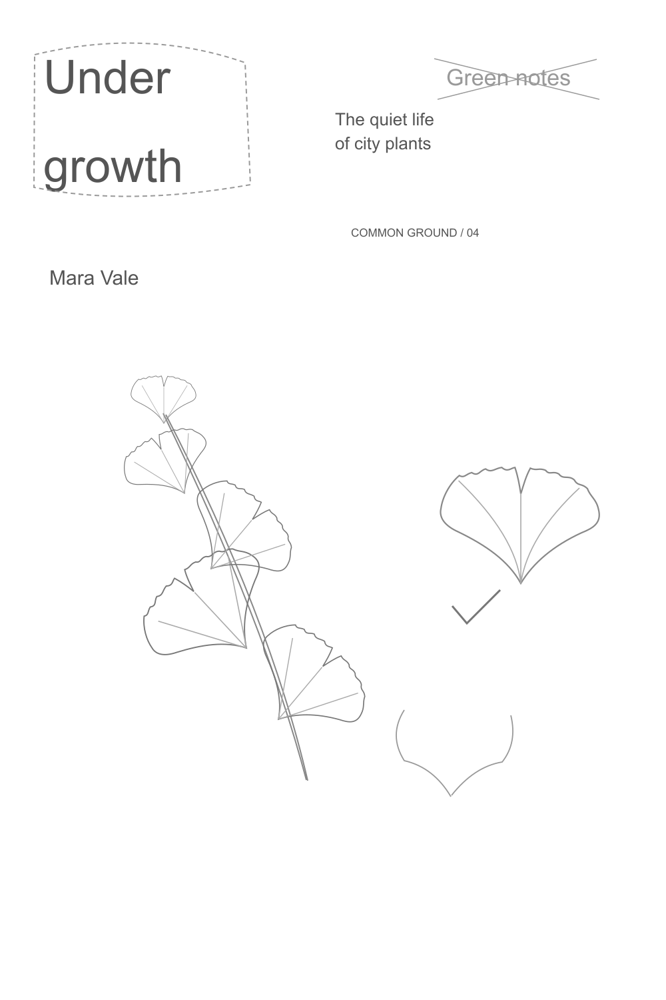
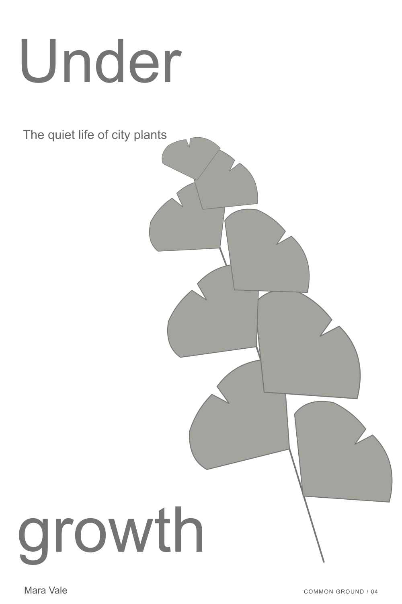
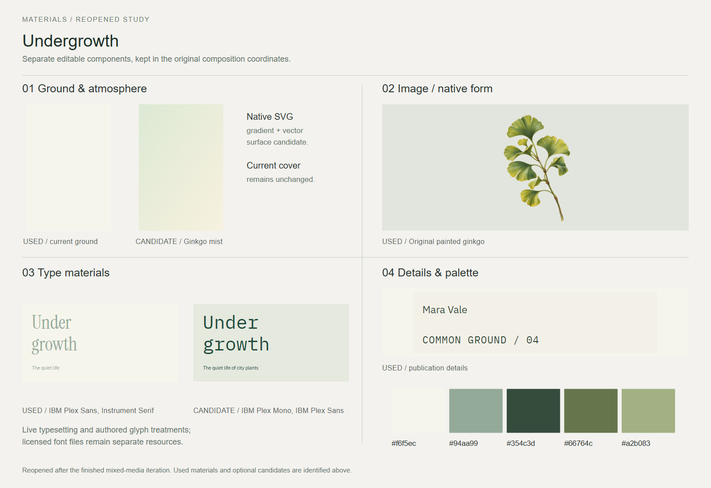
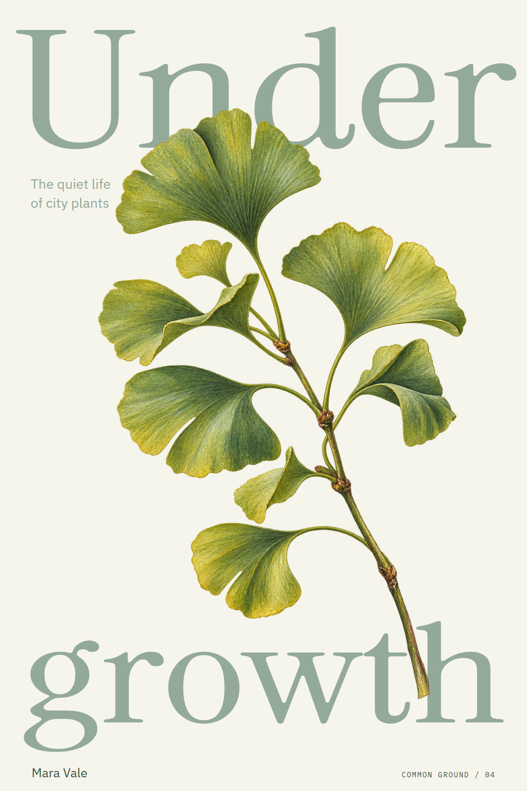

# Undergrowth

A city-plant field guide with oversized type and a ginkgo sprig.

[Back to the showcase](../../../README.md#nine-studies) · [Editable final](source/final-01.svg) · [Prompt record](prompts.json)

## Four views

### 01 · Ingredients

Rough components to select and combine.

### 02 · Composition

A neutral placement study for hierarchy and grouping.

### 03 · Asset studio

The visual assets and treatments considered for the assembly.

### 04 · Assembly and refinement

The selected design brought together for inspection and revision.

## Reusable stage prompts

These prompts were reconstructed from the study sources; they are not original transcripts.

| Stage | Reusable prompt |
| --- | --- |
| Ingredients | Gather the title, subtitle, ginkgo shapes and a quiet botanical palette. |
| Composition | Place oversized title words and foliage so both remain legible. |
| Asset studio | Develop an original ginkgo illustration and select the cover typography. |
| Assembly and refinement | Assemble the field guide cover; refine leaf placement and its overlap with the title. |

## Asset provenance

Recorded image prompt

**Asset 1:** `undergrowth-ginkgo.png`

> Use case: illustration-story. Asset type: original botanical illustration cutout for an illustrated plant field-guide cover; art asset only. Primary request: a fresh, richly observed ginkgo biloba sprig, one slender slightly curved stem rising diagonally from lower right toward upper left, with 10 to 12 naturally varied fan-shaped ginkgo leaves. The leaves must feel individually painted and observed, not duplicated symbols: some broad fans, some folded, one small young leaf, irregular scalloped margins and characteristic central notches, delicate radiating veins. Style: exquisite natural-history gouache and colored-pencil botanical plate, rich matte pigment, fine dry-brush and printed-paper texture within the paint, subtle waxy highlights, warm olive, pine, ochre and sage greens. Contemporary art-book illustration with real organic texture and graceful asymmetrical silhouette. Portrait composition, complete stem and leaves retained, no planter or pot, no surrounding objects. Genuine transparent background. No lettering, labels, borders, title, watermark, page or cover mockup. Entirely new artwork, not a copy of an existing botanical plate.

[Full prompt record](prompts.json)

The stages organize the work for review; they do not imply every artifact was produced in this order. The SVG contains editable layout and text; any embedded raster artwork remains raster.

## Editable materials

[Ingredient source](source/ingredients.svg) · [Composition source](source/composition-01.svg) · [Material board source](source/assets-board.svg) · [Reusable layer manifest](source/asset-kit/manifest.json) · [Font notices](../fonts/README.md)

Visual precedent: **Plant Fever — The World on the Windowsill**. Its visual approach informed this original study; reference artwork and source PDFs are not redistributed.
