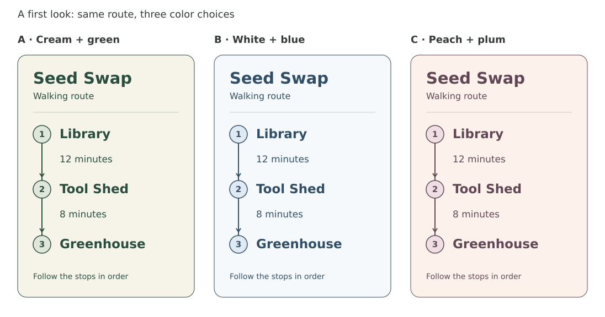
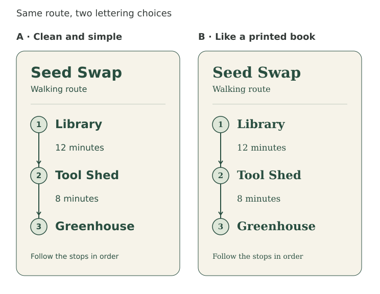
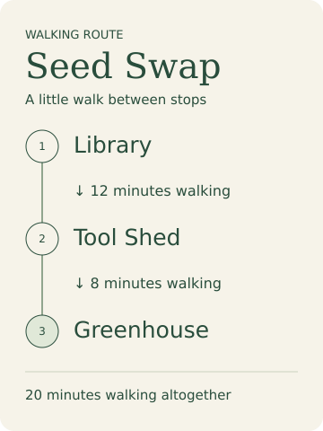
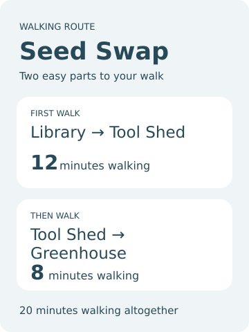
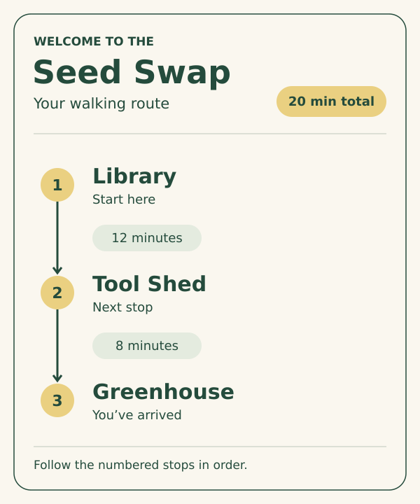

# A visual conversation, one choice at a time

These original fictional Seed Swap route cards come from a bounded source-loaded agent exercise. They show the observed behavior of a proposed instruction refinement, not a preferred release, a quality ranking or evidence of audience acceptance.

## Start with something to react to

The user wanted to find a calm, welcoming look together, without knowing design terms. The candidate produced palette samples using the same route, layout and lettering, then asked for a reaction before continuing.

[Edit the palette samples](candidate/palette.svg).

## Keep the color choice; explore lettering

The next synthetic user message chose moss green and cream and asked to see lettering on the same map. The candidate retained that palette, route content and geometry, varied the font family, then left the lettering choice open.

[Edit the lettering samples](candidate/lettering.svg). These particular sample counts were chosen during the exercise; they are not a workflow quota or required sequence.

## Compare the baseline

The baseline also made useful visual studies and paused for a reaction. Its initial comparison varied organizing ideas, palette and typography together:

| One connected route | Two separate walks |
| --- | --- |
|  |  |
| [Editable source](baseline/direction-a.svg) | [Editable source](baseline/direction-b.svg) |

After the same color-choice message, the baseline also kept its chosen working map and palette while showing [book-like](baseline/lettering-a.svg) and [simple](baseline/lettering-b.svg) lettering. This single exercise does not establish that the candidate is generally better or that the baseline fails at collaboration.

## Preserve the requested pace

Both versions made the settled heading-size edit without another design round: [baseline result](baseline/narrow.svg), [candidate result](candidate/narrow.svg), [original input](inputs/route.svg). Only `font-size="40"` became `font-size="34"`.

For a separate request to choose autonomously and deliver one SVG immediately, both did so: [baseline card](baseline/autonomous.svg), [candidate card](candidate/autonomous.svg).

The source SVGs keep editable text. Their generic font families depend on the viewer; the previews show one local rendering. No embedded fonts, physical print, visitor wayfinding, cross-editor behavior or user acceptance were qualified. The routes show walking order, not geographic directions.

See the [exact prompts](inputs/briefs.json) and [validation record](../../docs/progressive-collaboration-validation.md) for methods, checks and limits.
